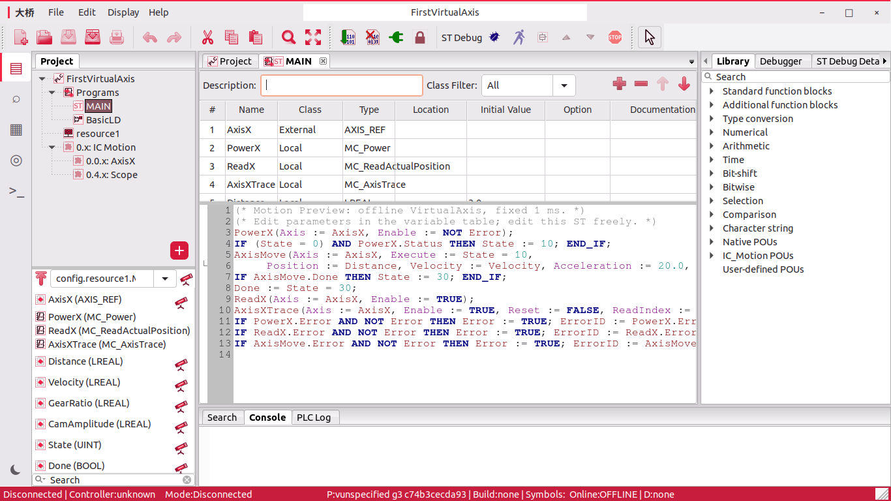
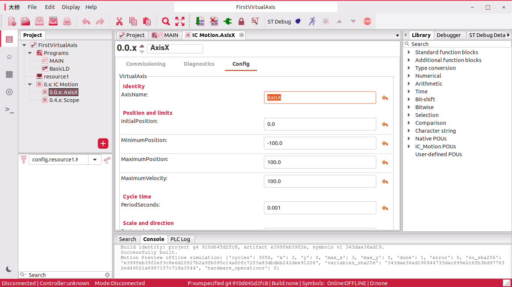
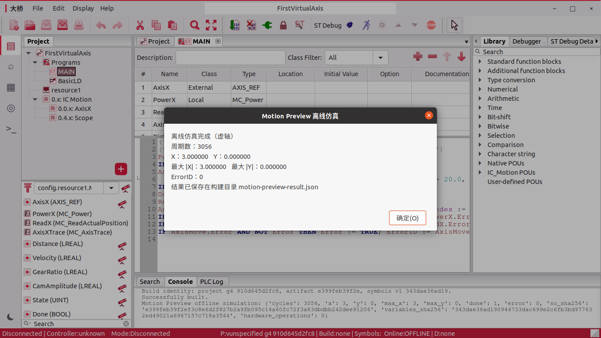

用途：让读者复现第一次虚轴定位。当前状态：V0.0.17 包内 Clean Build 与真实 IDE 离线仿真 PASS；实机未测试。

# 01 虚轴首次运动

| 项目 | 可复核值 |
| --- | --- |
| 所需 IDE | V0.0.17 Linux amd64 本地候选；包源码 `8f743aa19cc49012b5cfec38a49d15d95fb9facd` |
| 示例工程 | [`examples/v0.0.17/FirstVirtualAxis/`](https://github.com/Leo-Hassan/ic-motion-tutorial/tree/main/examples/v0.0.17/FirstVirtualAxis)，入口 `beremiz.xml` |
| 关键资源 | `plc.xml/MAIN`（ST）、`plc.xml/BasicLD`（未调度）、`IC Motion@ic_motion/AxisX@VirtualAxis/confnode.xml` |
| 工程来源提交 | `ic-beremiz-motion` `29ca588ca3e1190acf751e9e3353a30d5222f44d` 的模板生成器；V0.0.17 扩展提交 `0867ececc3224815e4f0aae07b76b9581f70cfe4` 重建验证 |
| 验证 | 包内 CLI 离线 Clean Build PASS；真实 V0.0.17 IDE `Ctrl+Alt+M` 仿真 PASS；实机 SKIP |

## 操作步骤

1. [核对 IDE 版本](../versions.md)后，用 `Ctrl+O` 选择 `examples/v0.0.17/FirstVirtualAxis/`。检查底部状态为 `Disconnected`、`Online:OFFLINE`。
2. 展开 **Programs → MAIN**，双击 `MAIN`，确认变量 `Distance=3.0`、`Velocity=1.0`，代码调用 `MC_Power` 与 `MC_MoveAbsolute`。展开 **IC Motion**，可见 `AxisX` 虚轴。
3. 双击 `AxisX`，在 **Config** 页确认初始位置 0、范围 -100..100、最大速度 100、周期 0.001 s。这些是示例软件参数。
4. 按 `Ctrl+S` 保存，在 IDE 执行离线 Build；也可从仓库根运行[软件操作](../operations.md)中的 Clean Build 命令。
5. 按 `Ctrl+Alt+M` 执行离线仿真。读取结果框的 X 位置、周期数和 ErrorID；在工程临时副本的 `build/motion-preview-result.json` 核对 `done`、`error`、`hardware_operations`。



*图 1：真实 V0.0.17 大桥 IDE，步骤 2。*



*图 2：真实 V0.0.17 大桥 IDE，步骤 3。*

## 关键 ST

以下摘自工程 `plc.xml/MAIN`，注释补充了命令交接和结果含义；完整代码以示例工程为准。

```iecst
(* 单次使能并等待虚轴可用；本例仅 LOCAL:// 虚轴。 *)
PowerX(Axis := AxisX, Enable := NOT Error);
IF (State = 0) AND PowerX.Status THEN State := 10; END_IF;

(* State=10 产生 Execute；完成后离开该状态，避免反复发命令。 *)
AxisMove(Axis := AxisX, Execute := State = 10,
    Position := Distance, Velocity := Velocity,
    Acceleration := 20.0, Deceleration := 20.0);
IF AxisMove.Done THEN State := 30; END_IF;
Done := State = 30;

(* 每个扫描周期读取反馈，并把错误交给程序状态。 *)
ReadX(Axis := AxisX, Enable := TRUE);
IF AxisMove.Error AND NOT Error THEN
    Error := TRUE;
    ErrorID := AxisMove.ErrorID;
END_IF;
```

## 预期结果与排错



*图 3：真实 V0.0.17 大桥 IDE，步骤 5；3056 个 1 ms 扫描后 X=3.0、ErrorID=0。*

本次离线结果：`cycles=3056`、`x=3`、`max_x=3`、`done=1`、`error=0`、`hardware_operations=0`。Clean Build 的 `project.so` SHA-256 为 `e399feb39f2ef3c8e6d2f827b2a9fb095c14a60fc72f3a83dbdbb242dee91206`，`VARIABLES.csv` 为 `343dae36ad190944733dac699e2c6fb3bd977632ed49021a6967157c718a3544`。

| 现象 | 检查位置 |
| --- | --- |
| 工程打不开 | 应选择含 `beremiz.xml` 的目录；核对包版本与 IC Motion 扩展。 |
| Build 报 POU 或变量错误 | 检查 `plc.xml/MAIN` 的 `AxisX` 外部变量、功能块声明和底部 Console；恢复工程副本后重试。 |
| 仿真拒绝真实轴或在线状态 | 检查 URI 为 `LOCAL://`、节点为 `VirtualAxis`、底部为 `Online:OFFLINE`；该仿真入口不运行真实轴。 |
| 位置未到 3 或 `ErrorID` 非 0 | 检查 `Distance`、`Velocity`、虚轴范围、1 ms 周期及状态机；保留结果 JSON 与编译日志。 |

**验证范围：**只在本机对工程临时副本执行构建与固定扫描的离线仿真；没有连接、部署或运动硬件，也没有硬实时保证。
