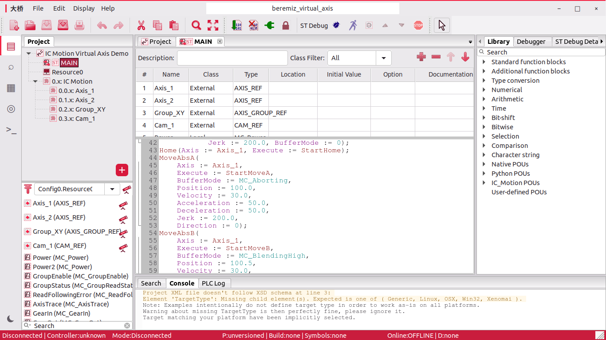
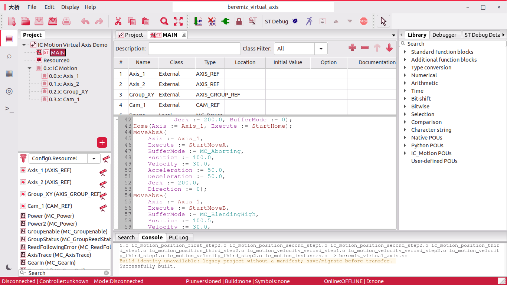

用途：演示在 ST 中以独立功能块实例排队并交接运动命令。当前状态：V0.0.17 示例 Clean Build、真实 IDE 编辑/构建与同源码 LookAhead 离线夹具 PASS；示例自身无自动仿真入口。

# 02 ST 功能块调用与命令交接

| 项目 | 可复核值 |
| --- | --- |
| 所需 IDE | V0.0.17 Linux amd64 本地候选；包源码 `8f743aa19cc49012b5cfec38a49d15d95fb9facd` |
| 示例工程 | [`examples/v0.0.17/beremiz_virtual_axis/`](https://github.com/Leo-Hassan/ic-motion-tutorial/tree/main/examples/v0.0.17/beremiz_virtual_axis)，入口 `beremiz.xml` |
| 关键 POU / 资源 | `plc.xml/MAIN`；`IC Motion@ic_motion/Axis_1@VirtualAxis/confnode.xml`、`Axis_2@VirtualAxis`、`Group_XY@AxisGroup` |
| 源码提交 | `ic-beremiz-motion` `0867ececc3224815e4f0aae07b76b9581f70cfe4`；复制的 12 个跟踪文件原样保留 |
| 当前验证 | V0.0.17 包内 CLI Clean Build 与真实 IDE Build PASS；同提交 `tests/Test_LookAhead.st` 配套离线测试 PASS；本示例自身的 GUI 仿真 SKIP |

## 操作步骤

1. 核对[版本](../versions.md)后，在 IDE 用 `Ctrl+O` 打开工程目录。确认状态栏 `Online:OFFLINE`，展开 **IC Motion**，可见 `Axis_1`、`Axis_2`、`Group_XY`、`Cam_1`。
2. 双击 **MAIN**。变量表中 `StartMoveA/B/C/D` 初值均为 `FALSE`，下方 ST 有四个独立 `MC_MoveAbsolute` 实例。先定位 `MoveAbsA` 的 `MC_Aborting`，再检查 B/C/D 的 `MC_BlendingHigh` 与终点 100.5、101.0、101.5。
3. 在工程临时副本中编辑 ST，保存；按 `F11` 执行离线 Build，底部 Console 应显示 `Successfully built.`。也可运行 `scripts/clean_build.sh <V0.0.17包目录> examples/v0.0.17/beremiz_virtual_axis V0.0.17`。
4. 复现交接行为时，使用同一源码提交的 `ic-beremiz-motion/tests/Test_LookAhead.st` 与 `V10_ST_LookAhead` 离线夹具。该夹具自行发 A、B、C、D 的上升沿，并检查 B/C/D 排队、交接和最终位置；它不连接 IDE Runtime 或真实轴。下面的夹具结果**不是**此手动示例的 GUI 运行结果。



*图 1：真实 V0.0.17 大桥 IDE，步骤 2；`MAIN` 的 `MoveAbsA/B`、独立请求和工程树可见。*

## 关键 ST 与交接时序

下面参数摘自示例 `plc.xml/MAIN`；注释说明读代码时应检查的关系，省略未改动的加减速度和 Jerk 字段。

```iecst
(* A 先取得 Axis_1；MC_Aborting 可抢占正在活动的旧命令。 *)
MoveAbsA(Axis := Axis_1, Execute := StartMoveA,
         BufferMode := MC_Aborting, Position := 100.0,
         Velocity := 30.0, Acceleration := 50.0,
         Deceleration := 50.0, Jerk := 200.0, Direction := 0);

(* A 活动后，对 B 发新的上升沿；B 应先 Busy，尚未 Active。 *)
MoveAbsB(Axis := Axis_1, Execute := StartMoveB,
         BufferMode := MC_BlendingHigh, Position := 100.5,
         Velocity := 30.0, Acceleration := 50.0,
         Deceleration := 50.0, Jerk := 200.0, Direction := 0);

(* C/D 是同轴独立实例，分别接到 101.0 和 101.5。 *)
MoveAbsC(Axis := Axis_1, Execute := StartMoveC,
         BufferMode := MC_BlendingHigh, Position := 101.0,
         Velocity := 30.0, Acceleration := 50.0,
         Deceleration := 50.0, Jerk := 200.0, Direction := 0);
MoveAbsD(Axis := Axis_1, Execute := StartMoveD,
         BufferMode := MC_BlendingHigh, Position := 101.5,
         Velocity := 30.0, Acceleration := 50.0,
         Deceleration := 50.0, Jerk := 200.0, Direction := 0);
```

在配套夹具中，先 `Power.Status`，再使 A 活动；仅在 A 活动后给 B 上升沿，见 B `Busy=TRUE`、`Active=FALSE` 才撤销请求并给 C；对 D 同理。夹具使用更短的 5.00、5.02、5.04、5.06 位置以便有界离线测试，**不能把它的终点 5.06 写成示例的 101.5**。

## 预期结果与常见错误



*图 2：真实 V0.0.17 大桥 IDE，步骤 3；Console 显示构建成功及旧工程无 manifest 的提示。*

本次示例 Clean Build 成功：`project.so` SHA-256 `8d0b2419f4bacbfaadf5c7f5e2eee59316f5836d367d9e1cc690e0af07348328`，变量表 `4c0baaeb12a959a0a65b1a9c54d9cd82f013396d6d6d27d9f9e4984a24df1f13`。由于原项目无 manifest，构建显示 `Build identity unavailable`；这不是构建失败，**不可据此进行 Transfer**。

同源码配套 `V10_ST_LookAhead` 离线执行结果为 `cycles=2753`、`queued=3`、`handovers=3`、`final=5.06`，首接点采样速度约 `0.268..0.275` 单位/s。它验证独立实例的排队/交接语义；示例工程本身没有自动触发请求，未做 GUI 仿真。

| 现象 | 检查位置 |
| --- | --- |
| B/C/D 一直不活动 | 先确认 `Power.Status` 与 A 已 `Active`，再给后续请求新的上升沿；`Execute` 复位后才能重发。 |
| 后续命令抢占 A | 检查后续块是否误设为 `MC_Aborting`；本例要求 `MC_BlendingHigh`。 |
| 轴/组占用冲突 | 保持 `EnableGroup`、`EnableGear`、`EnableCam` 为 `FALSE`，先只验证同轴 A/B/C/D。 |
| 构建提示无 manifest | 这是旧示例来源身份告警；本章仅做离线构建，不能当成部署许可。 |

**验证范围：**真实 IDE 的编辑与构建，及同源码的主机固定扫描夹具；没有对本示例执行在线变量写入、Force、板端操作、真实电机运动或硬实时验收。
