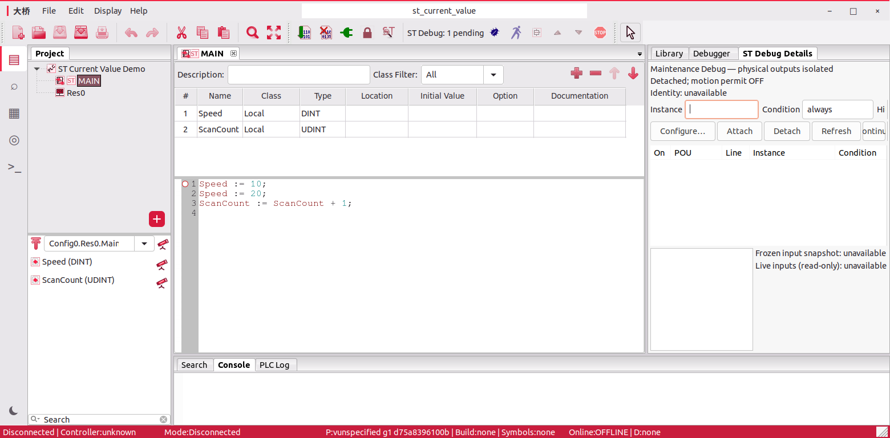
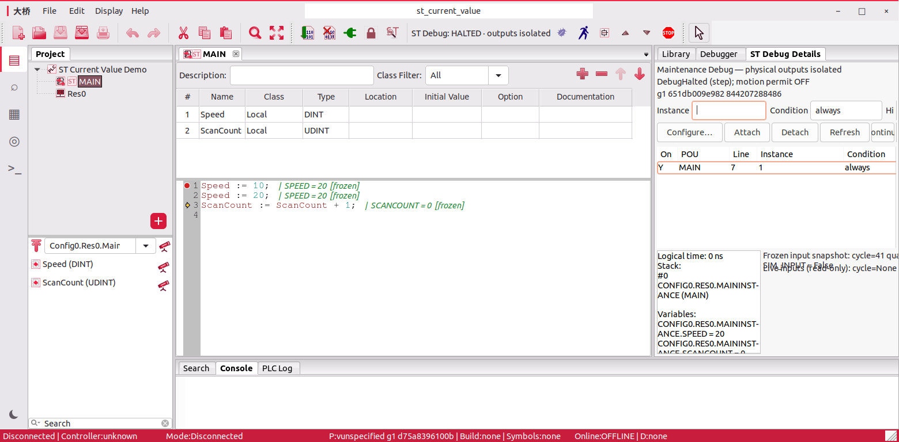
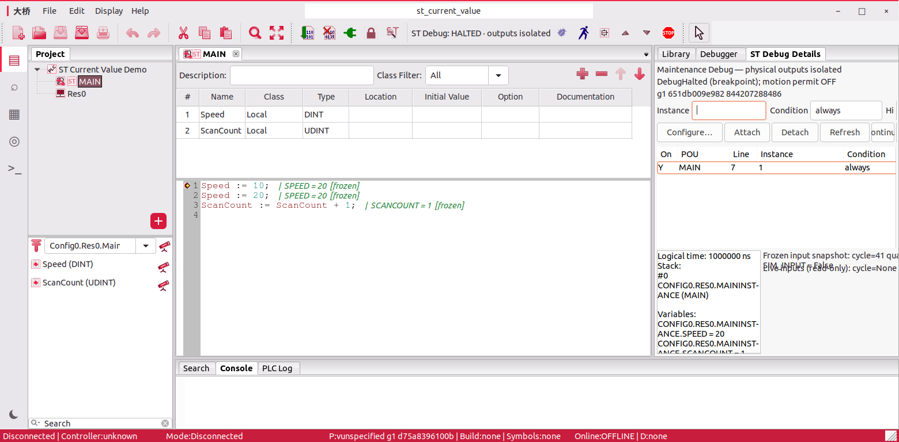
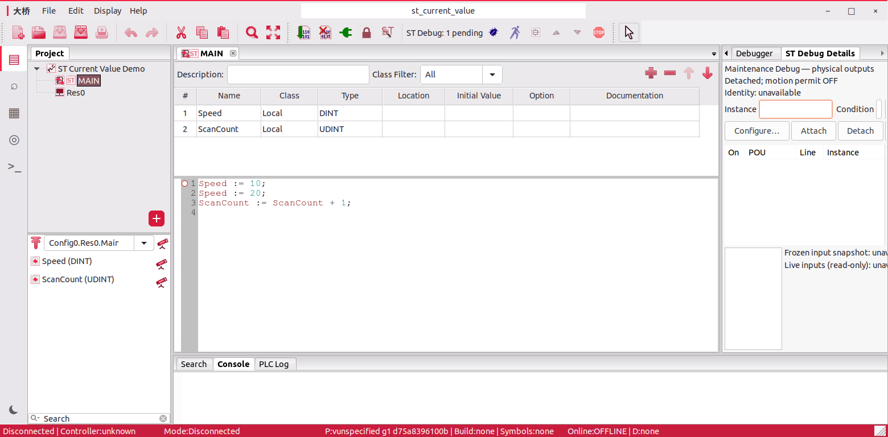

用途：演示 V0.0.17 ST 断点、继续、单步、当前变量值和退出。当前状态：包内工程 Clean Build、真实 MATIEC/wx/eRPC 主机回环及完整 IDE 窗口演示 PASS；生产设备调试未验证。

# 03 ST 断点与单步调试

| 项目 | 可复核值 |
| --- | --- |
| 所需 IDE | V0.0.17 Linux amd64 本地候选；包源码 `8f743aa19cc49012b5cfec38a49d15d95fb9facd` |
| 可打开工程 | [`examples/v0.0.17/st_current_value/`](https://github.com/Leo-Hassan/ic-motion-tutorial/tree/main/examples/v0.0.17/st_current_value)，入口 `beremiz.xml` |
| 关键 POU / 资源 | `plc.xml/MAIN` 三条 ST 语句；`Config0/Res0/MainTask` 20 ms；同目录 `maintenance_debug.st` 是维护候选编译输入 |
| 源码提交 | `beremiz` `06f5b1e0e45faecac96d790ab03e57be46d4fd2d`，原路径 `tests/projects/st_current_value/`；调试工具 `ic-matiec-adapter` `01e4b4897b6d7a002d26169314687e8154f29c5c` |
| 本次验证 | V0.0.17 包内 Clean Build PASS；真实 wx/eRPC 编译候选回环测试 PASS；完整大桥 IDE 的本地回环截图覆盖断点、单步、继续和退出；板端/生产调试 SKIP |

## 准备与操作步骤

1. 核对[包版本](../versions.md)。在 V0.0.17 IDE 用 `Ctrl+O` 打开上述工程。双击工程树的 **MAIN**，确认变量表 `Speed : DINT`、`ScanCount : UDINT` 与下方三条 ST 语句；状态栏应为 `Online:OFFLINE`。
2. 在工程临时副本上按 `F11` 做离线 Build；也可运行 `scripts/clean_build.sh <V0.0.17包目录> examples/v0.0.17/st_current_value V0.0.17`。本工程不包含物理 I/O 或运动库。编辑器第一条 `Speed := 10;` 左侧单击断点边栏，出现待绑定的红色空心标记；打开右侧 **ST Debug Details**。
3. 离线维护调试需要受限候选、源映射、已停止的 Runtime 身份及只读/冻结输入证据。V0.0.17 包**未附带** `ic_matiec_maintenance_debug` 主机库，因此仅有发布包不能直接完成此回环步骤。用下方脚本在主机构建工具库并执行包内真实 MATIEC、wx、eRPC 测试；它不连接开发板。图 2～6 来自同包完整大桥 IDE 窗口上的本地回环集成：测试夹具提供匹配工程身份和只绑定 `127.0.0.1` 的已停止 Runtime，真实 IDE 面板执行 Attach/Step/Continue/Detach。它不是生产 Runtime 的部署证明。
4. 在完整 IDE 本地回环中，选择本机权限为 `0600` 的调试会话描述文件后点 **Attach/Start ST source debug**。首次停在第一条语句**之前**，`Speed=0`。断点由待绑定标记变为已安装的实心标记；右侧显示 `DebugHalted (entry)` 和输出隔离。
5. 点 **Step over** 或按 `F10` 一次，停在第二条语句前，`Speed=10`；再按一次，停在 `ScanCount` 语句前，`Speed=20`。编辑器两处 `Speed` 旁的绿色值均为当前暂停快照，不是逐行历史值。
6. 点 **Continue**（工具提示 `F5`），执行完本次扫描后在下一扫描的第一条断点再次停住。`ScanCount=1`，`Speed=20`。点 **Detach/Stop ST source debug** 退出，调试面板回到 `Detached; motion permit OFF`，内联值消失。退出调试不执行板端 PLC Stop。



*图 1：步骤 2；真实 V0.0.17 工程树、ST 编辑器第一行空心断点和 `ST Debug: 1 pending`。*


*图 2：步骤 4；完整 IDE 本地回环已 Attach，`DebugHalted (entry)`，两处内联 `SPEED=0 [frozen]`。*


*图 3：步骤 5；第一次 Step over，下一语句前暂停，内联 `SPEED=10`。*



*图 4：步骤 5；第二次 Step over，`SPEED=20`，`SCANCOUNT=0`；工程树和右侧 Debug Details 同屏。*



*图 5：步骤 6；Continue 后在下一扫描重新停于断点，`SCANCOUNT=1`。*



*图 6：步骤 6；Detach 后 `ST Debug: 1 pending`，面板显示 Detached，内联值移除。*

## ST 与主机回环验证

工程 `plc.xml/MAIN` 的实际 ST 如下。注释是阅读说明；可打开工程的三条赋值本身未添加注释，以保证源码映射行号与截图一致。

```iecst
(* 进入第一条语句前，Speed 的 DINT 初值为 0。 *)
Speed := 10;
(* 单步到此行前，两处 Speed 均显示当前值 10。 *)
Speed := 20;
(* 再单步到此行前，Speed 当前值为 20，ScanCount 仍为 0。 *)
ScanCount := ScanCount + 1;
```

在并列工作区取得 `ic-matiec-adapter` 上述提交及其相邻模块源码后，先构建主机调试库，再在教程仓库根运行：

```sh
cmake -S /path/to/ic-matiec-adapter -B /tmp/ic-matiec-host \
  -DIC_PLC_RUNTIME_SOURCE_DIR=/path/to/ic-plc-runtime \
  -DIC_HAL_SOURCE_DIR=/path/to/ic-hal \
  -DIC_AXIS_SOURCE_DIR=/path/to/ic-axis \
  -DIC_MOTION_SOURCE_DIR=/path/to/ic-motion
cmake --build /tmp/ic-matiec-host --target ic_matiec_maintenance_debug
./scripts/verify_st_debug_loopback.sh \
  /path/to/ic-platform-V0.0.17-linux-amd64 \
  examples/v0.0.17/st_current_value \
  /path/to/ic-matiec-adapter \
  /tmp/ic-matiec-host/libic_matiec_maintenance_debug.so
```

脚本只在临时目录生成候选 SO、源映射和维护清单，并调用**包内** `test_maintenance_debug_erpc_gui.py --current-value`。本次返回 `real MATIEC + eRPC + wx inline Speed 0 -> 10 -> 20; Continue and Detach PASS`。可打开工程的包内 Clean Build 两次均成功，`VARIABLES.csv` SHA-256 均为 `7cee8bc84447ebe4ee558eb50916ee08be26d39305ff08ace65cfb724e2ad4df`；临时路径不同的两次 `project.so` SHA-256 分别为 `0857c153d1a0ce847842924906a38843ebe3c06dd75b5b417fe4de81dbb7bd25`、`9ed2b41d6ca49b113976e8f35632cce42429fa497bf8e4a0af3b73bc53077636`，不把 SO 哈希相等作为本例通过条件。这些是离线构建证据，**不是**本地回环中候选 SO 的哈希。

## 常见错误与验证范围

| 现象 | 检查位置 |
| --- | --- |
| 断点仍为空心、未进入调试 | 检查是否已配置本机维护会话、身份与源映射哈希是否匹配；仅离线打开工程不会自动 Attach。 |
| `MAINTENANCE_DEBUG_MAP_MISMATCH` | 工程 `project-manifest.json` 的 generation、候选 map 的生成代数与清单哈希必须一致；不能混用不同 Build 的 map。 |
| `MAINTENANCE_DEBUG_COMMAND_TIMEOUT` | 本地回环夹具使用隔离子进程；主机脚本须有 `if __name__ == "__main__"` 入口保护，避免 spawn 重入。 |
| 单步后两处 Speed 值相同 | 这是冻结时刻的**当前值**，不是各语句上次写入值；按上文 0→10→20 核对。 |
| 生产 Runtime 只读监视 | 只从获准的在线监视通道读取变量，不用维护候选的断点/单步，也不写变量、Force 或执行板端控制。此章**没有**生产监视实测。 |

**验证范围：**当前 V0.0.17 的主机 Clean Build、真实 wx/eRPC 隔离调试、完整 IDE 本地回环界面。截图虽为真实软件窗口，其 Runtime 身份由本地主机测试夹具提供；没有开发板 Connect、Stop、Transfer、Run、Force、SDO 写入、电机运动或生产只读监视验收。
