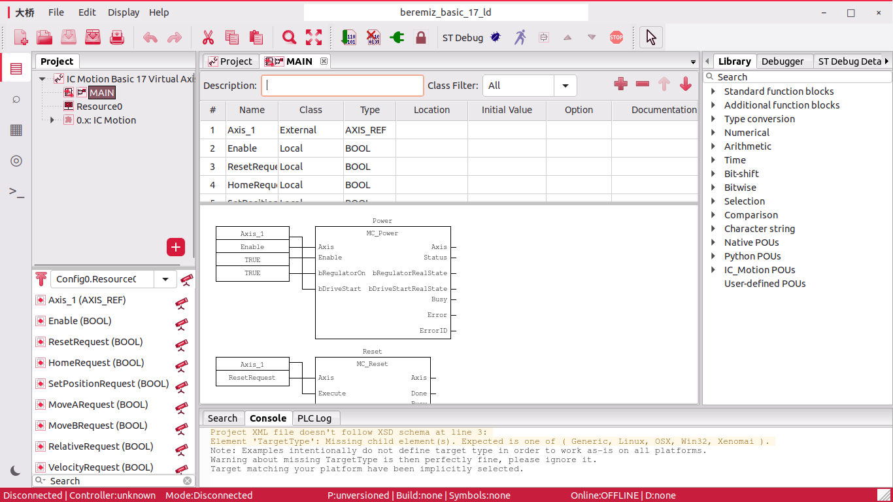
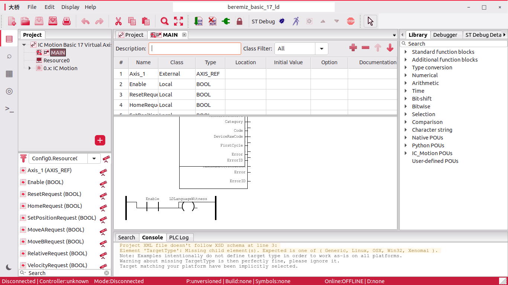
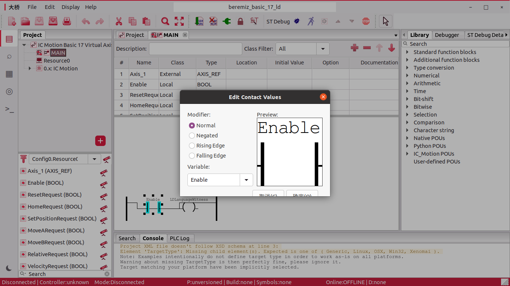
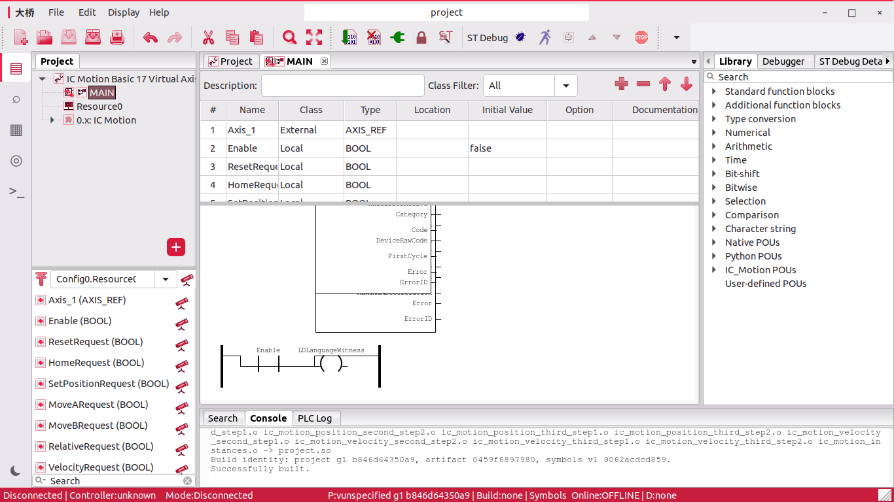
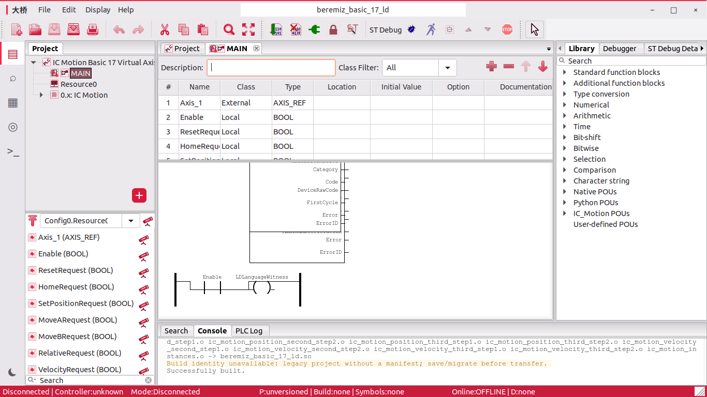
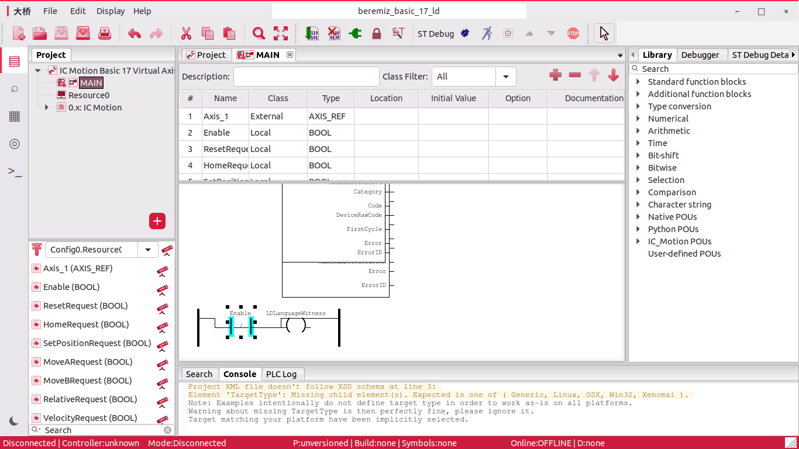
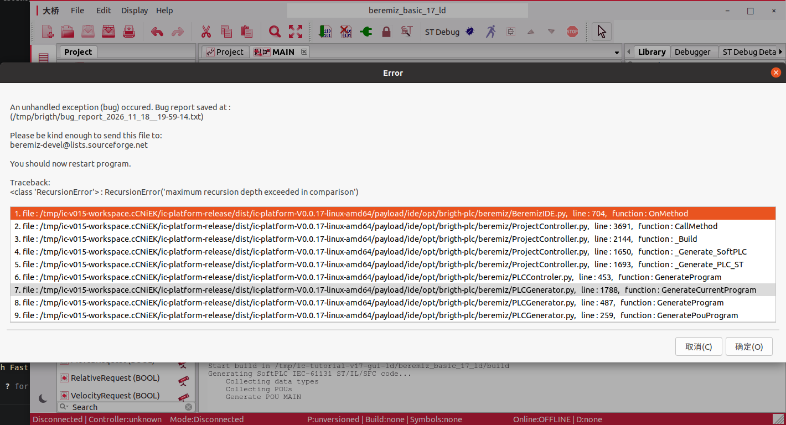

用途：演示真实 LD 工程的触点、线圈、功能块、编辑、构建和离线执行，并记录 V0.0.17 触点取反缺陷。当前状态：原工程及变量初值编辑后的临时副本 Clean Build、真实 IDE 构建和夹具仿真 PASS；触点取反后构建 FAIL，实机 SKIP。

# 04 梯形图（LD）编辑与仿真

| 项目 | 可复核值 |
| --- | --- |
| 所需 IDE | V0.0.17 Linux amd64 本地候选；包源码 `8f743aa19cc49012b5cfec38a49d15d95fb9facd` |
| 示例工程 | [`examples/v0.0.17/beremiz_basic_17_ld/`](https://github.com/Leo-Hassan/ic-motion-tutorial/tree/main/examples/v0.0.17/beremiz_basic_17_ld)，入口 `beremiz.xml` |
| 关键 POU / 资源 | `plc.xml/MAIN` 的真实 `<LD>` 正文；`IC Motion@ic_motion/Axis_1@VirtualAxis/confnode.xml`；`Config0/Resource0/MotionTask` |
| 源码提交 | `ic-beremiz-motion` `0867ececc3224815e4f0aae07b76b9581f70cfe4`；复制 6 个跟踪文件，保留原生 LD 格式 |
| 当前验证 | 原工程和 `Enable` 初值编辑后的临时副本：真实 IDE `F11`、两次包内 Clean Build、18 实例检查与虚轴扫描 PASS；另一临时副本触点取反后的 Build FAIL |

## 操作步骤

1. 在 V0.0.17 IDE 中 `Ctrl+O` 选择 `examples/v0.0.17/beremiz_basic_17_ld/`。双击工程树的 **MAIN**，应进入图形化 **LD** 编辑器，而不是 ST 文本页。
2. 在 LD 图上查看 `Power : MC_Power`，输入 `Axis_1`、`Enable`、两个 `TRUE`，以及输出 `Status/Busy/Error`。向下滚动可看到 `MoveAbsA/B`、`MC_Stop`、各类 Read 块。
3. 滚动到图底部，核对 `Enable` 常开触点接 `LDLanguageWitness` 线圈，两者由左、右电源轨连接。此梯级在真实 LD 编辑器中可查看和选择；本版触点取反后的构建缺陷见下文。它不参与运动仲裁。
4. 在**临时副本**的 `MAIN` 编辑页上方变量表，双击 `Enable` 行的 **Initial Value** 空格，填 `FALSE` 并按 Enter，再按 `Ctrl+S` 保存。BOOL 缺省初值本来就是 FALSE，因此这是不改变运动请求语义的可见编辑。按 `F11`，Console 应显示 `Successfully built.`。双击下方 `Enable` 触点还可打开真实 **Edit Contact Values** 对话框；本版先保持 **Normal**，取消关闭。本轮另在独立临时副本把触点改成 **Negated** 并保存，出现下文所述的 V0.0.17 构建缺陷；不要把失败副本用于后续仿真。
5. 在教程仓库根目录对原工程或保存后的初值编辑副本运行下列脚本。它调用包内 `ic-beremiz-motion/tests/test_beremiz_basic17_build.py`，对指定 LD 工程两次 Clean Build，确认 17 类块、18 个实例，然后在主机虚轴上扫描 PLC：使能、Home、故障与 Reset、A/B 排队、抢占、Stop 保位及新上升沿重启。若要核对编辑后的副本，将第二个参数改为该副本目录。它**不是** IDE `Ctrl+Alt+M` 的批量模板仿真。

```sh
./scripts/verify_basic17_ld.sh \
  /path/to/ic-platform-V0.0.17-linux-amd64 \
  examples/v0.0.17/beremiz_basic_17_ld V0.0.17
```



*图 1：步骤 2；实际 `LD_Viewer` 显示 `MC_Power` 和 `MC_Reset` 调用，左侧为工程树。*



*图 2：步骤 3；同一可编辑 `MAIN` 梯形图底部的 `Enable` 触点与 `LDLanguageWitness` 线圈。*



*图 3：真实 V0.0.17 IDE，步骤 4；图形触点可双击进入参数对话框。此截图打开的是未修改的 Normal 触点。*

## 带注释的 LD 梯级

下面是 `plc.xml/MAIN` 中真实连接的读图写法；完整可编辑图以工程 XML 和 IDE 为准。

```text
左电源轨 ──[ Enable ]────────( LDLanguageWitness )── 右电源轨
               常开触点          普通线圈
说明：Enable 为 TRUE 时，扫描将 LDLanguageWitness 置 TRUE。

Power : MC_Power
  Axis          ← Axis_1    // 虚轴引用
  Enable        ← Enable    // 使能请求
  bRegulatorOn  ← TRUE      // 本例输入常量
  bDriveStart   ← TRUE      // 本例输入常量
  Status/Busy/Error → 块输出 // 在 LD 图中查看，不要当作实轴反馈
```

## 预期结果与常见错误



*图 4：步骤 4；真实 V0.0.17 IDE 中将 `Enable` 初值设为显式 `false` 后保存并 `F11`，同屏有触点、线圈、工程树和 `Successfully built.`。这是临时副本，教程原工程未改。*



*图 5：原始 LD 工程在 V0.0.17 IDE `F11` 构建成功。旧工程缺 manifest 的身份提示保留。*

原工程与初值编辑副本的 LD Clean Build 均得到 `project.so` SHA-256 `0459f68979803641e453a5d30a2fdddfac5c04eb4c7b5f181ab8a82d00a4a7ec`、变量表 `9062acdcd8599bdbc73f6d039abf1f3cf3f55e9788d81e37f385fb1ec54edbe9`。编辑副本单独运行保存工程夹具 1/1 PASS、耗时 282.779 秒；对 LD 执行两次 Clean Build，哈希一致，并验证虚轴扫描；对应 ST 工程也通过相同门禁。它检查 A/B 排队最终到达 -50、Stop 后位置保持以及新 A 上升沿被接收；这些是主机仿真，不是设备结果。

| 现象 | 检查位置 |
| --- | --- |
| 打开后看到 ST | 核对选择的是 `beremiz_basic_17_ld`，而不是相邻的 `beremiz_basic_17`；`plc.xml/MAIN` 必须是 `<LD>`。 |
| 图形元素连线断开 | 检查触点 localId 97 的输入来自左电源轨 96，线圈 98 输入来自触点 97，右轨 99 接线圈 98。 |
| 构建报变量或块类型错误 | 检查 `Axis_1` 外部变量、`Enable` BOOL 和块输入端，不要直接改写生成的 PLCopen XML。 |
| `Build identity unavailable` | 旧工程无 manifest，离线构建可继续；不能把该提示当成可部署身份。 |
| 在本版修改触点为 Negated 后 Build 弹 `RecursionError` | 已在临时副本真实复现：保存的 `plc.xml` 中触点 97 除原左轨 96 外还错误引用线圈 98，线圈 98 又引用触点 97，形成回环。返回未修改的教程工程副本再构建；此 V0.0.17 编辑路径记为 FAIL，不把原工程 PASS 外推为编辑后 PASS。 |



*图 6：真实 V0.0.17 IDE 中的取反触点编辑结果；该副本随后的 `F11` 构建失败，仅用于缺陷说明。*



*图 7：同一临时副本按 `F11` 后的真实 IDE 错误；`RecursionError` 出现在 PLC 生成阶段。*

**验证范围：**原工程和初值编辑副本的真实 LD 编辑器、主机 Clean Build 与保存工程固定扫描仿真已验证；触点取反后构建路径明确失败。没有连接、Transfer、Run、Force、SDO 写入、实轴或硬实时验收。
