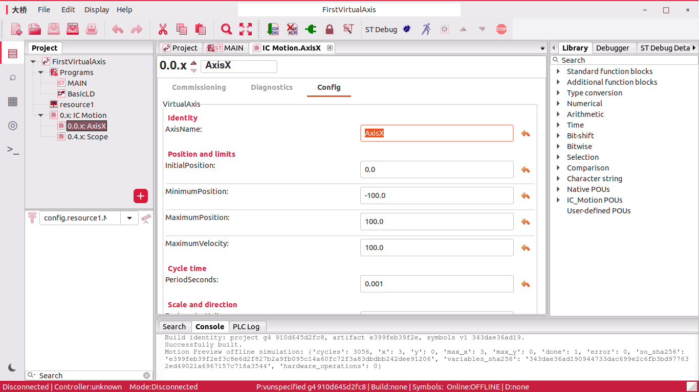
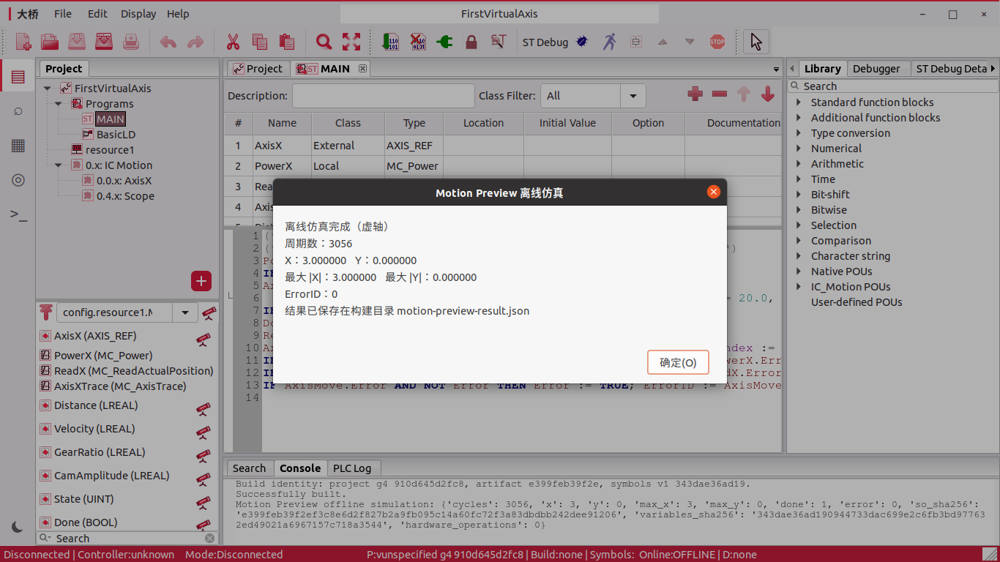

用途：核对虚轴资源的单位、周期和位置/速度边界，再运行有界离线定位。当前状态：与案例 01 共用同一工程及真实 IDE 配置截图，V0.0.17 Clean Build、GUI 离线仿真 PASS；越界故障注入未验证，实轴 SKIP。

# 05 轴配置和限位

| 项目 | 可复核值 |
| --- | --- |
| 所需 IDE | V0.0.17 Linux amd64 本地候选；包源码 `8f743aa19cc49012b5cfec38a49d15d95fb9facd` |
| 示例工程 | [`examples/v0.0.17/FirstVirtualAxis/`](https://github.com/Leo-Hassan/ic-motion-tutorial/tree/main/examples/v0.0.17/FirstVirtualAxis)，入口 `beremiz.xml`；与案例 01 为同一字节内容 |
| 关键资源 | `IC Motion@ic_motion/AxisX@VirtualAxis/confnode.xml`；`plc.xml/MAIN`；`config/resource1/MotionTask` |
| 工程来源 | `ic-beremiz-motion` 模板生成器提交 `29ca588ca3e1190acf751e9e3353a30d5222f44d`；V0.0.17 扩展锁定 `0867ececc3224815e4f0aae07b76b9581f70cfe4` |
| 当前验证 | 同一工程 V0.0.17 包内 Clean Build、真实 GUI `Ctrl+Alt+M` 固定扫描仿真 PASS；软件配置页已在真实包内 IDE 截图；实机限位与故障注入 SKIP |

## 操作步骤

1. 在 V0.0.17 IDE 选择 `Ctrl+O`，打开工程目录。确认底栏 `Online:OFFLINE` 和工程树 `IC Motion → AxisX`。
2. 双击 `AxisX`，在 **Config** 页核对 `InitialPosition=0`、`MinimumPosition=-100`、`MaximumPosition=100`、`MaximumVelocity=100`、`MaximumAcceleration=100`、`MaximumDeceleration=100`、`PeriodSeconds=0.001`。本例的位置、速度单位是虚轴工程单位，不能直接当成实轴转数或 counts。
3. 双击 `MAIN`，确认 `Distance=3.0`、`Velocity=1.0`；目标 3.0 在当前 -100..100 的配置范围内，速度请求 1.0 小于配置上限 100。核对 `MotionTask` 的周期为 1 ms，与虚轴 `PeriodSeconds` 一致。
4. 保存后按 `F11` 做离线 Build；或在教程仓库根运行 `scripts/clean_build.sh <V0.0.17包目录> examples/v0.0.17/FirstVirtualAxis V0.0.17`。按 `Ctrl+Alt+M` 做主机虚轴仿真，查看完成位置和 ErrorID。这里复用案例 01 已记录的同一工程实测，不额外宣称越界故障处理通过。



*图 1：步骤 1～2；真实 V0.0.17 包内 IDE 展示 `AxisX`、配置边界和工程树。截图来源见[图片来源](../../assets/images/v0.0.17/PROVENANCE.md)。*

## 关键配置和带注释 ST

配置文件的关键字段如下；完整文件以示例工程为准。

```xml
<VirtualAxis AxisName="AxisX" InitialPosition="0"
  MinimumPosition="-100" MaximumPosition="100"
  MaximumVelocity="100" MaximumAcceleration="100"
  MaximumDeceleration="100" PeriodSeconds="0.001" />
```

```iecst
(* 先使能 LOCAL:// 虚轴；这不是驱动器使能。 *)
PowerX(Axis := AxisX, Enable := NOT Error);

(* 在当前配置范围内请求位置 3.0、速度 1.0。 *)
AxisMove(Axis := AxisX, Execute := State = 10,
    Position := Distance, Velocity := Velocity,
    Acceleration := 20.0, Deceleration := 20.0);

(* 在每个扫描周期读虚轴反馈；错误码保留为程序输出。 *)
ReadX(Axis := AxisX, Enable := TRUE);
IF AxisMove.Error AND NOT Error THEN
    Error := TRUE;
    ErrorID := AxisMove.ErrorID;
END_IF;
```

## 预期结果与常见错误



*图 2：步骤 4；同一工程的真实 V0.0.17 离线结果：3056 周期、X=3.000000、ErrorID=0。*

同一工程 Clean Build 的 SO SHA-256 为 `e399feb39f2ef3c8e6d2f827b2a9fb095c14a60fc72f3a83dbdbb242dee91206`，变量表为 `343dae36ad190944733dac699e2c6fb3bd977632ed49021a6967157c718a3544`；固定扫描输出 `done=1`、`error=0`、`hardware_operations=0`。这些结果只覆盖目标在配置范围内的情况。

| 现象 | 核对位置 |
| --- | --- |
| 离线仿真拒绝执行 | 工程应为 `LOCAL://`、Linux 目标、`VirtualAxis`，且没有真实轴或传输节点。 |
| 周期不匹配 | `AxisX` 的 `PeriodSeconds=0.001`，`MotionTask` 必须为 1 ms。 |
| 目标位置或速度不符合预期 | 检查 `MAIN` 的 `Distance/Velocity` 和 `AxisX` 配置字段；不要仅依据画面单位推测设备 counts。 |
| 修改配置后加载报身份不匹配 | 带 `project-manifest.json` 的工程须通过 IDE 保存，使源码和工程身份一起更新；勿直接改 XML 后沿用旧 manifest。 |

**验证范围：**配置读取、相同源码的离线构建和虚轴范围内运动仿真已验证；本版未做越界错误注入、物理限位开关、驱动器参数或实机安全验收。
