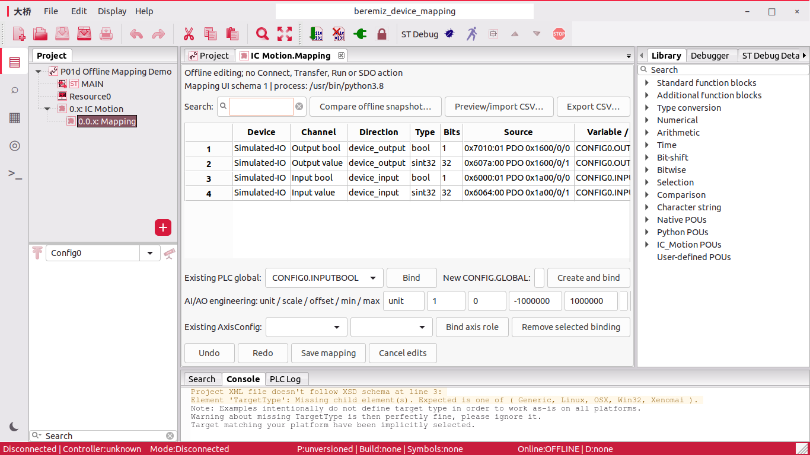
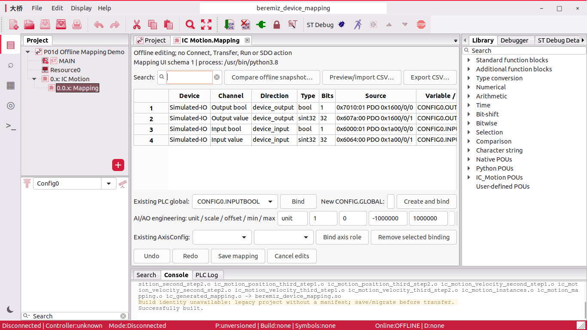
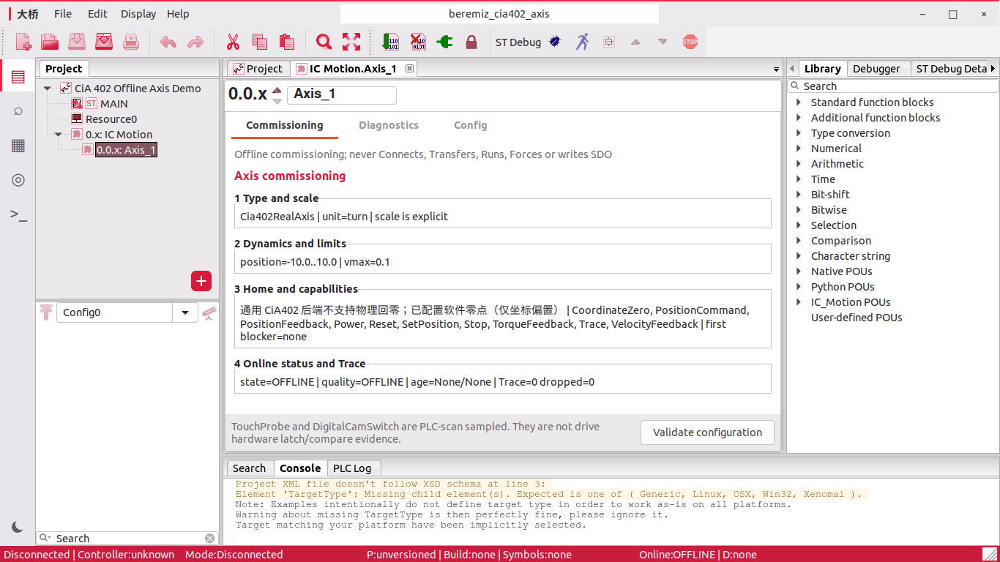
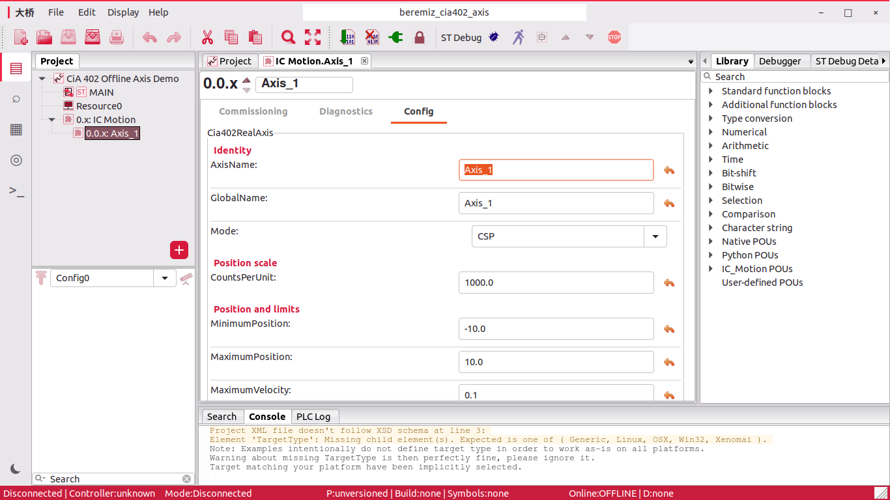
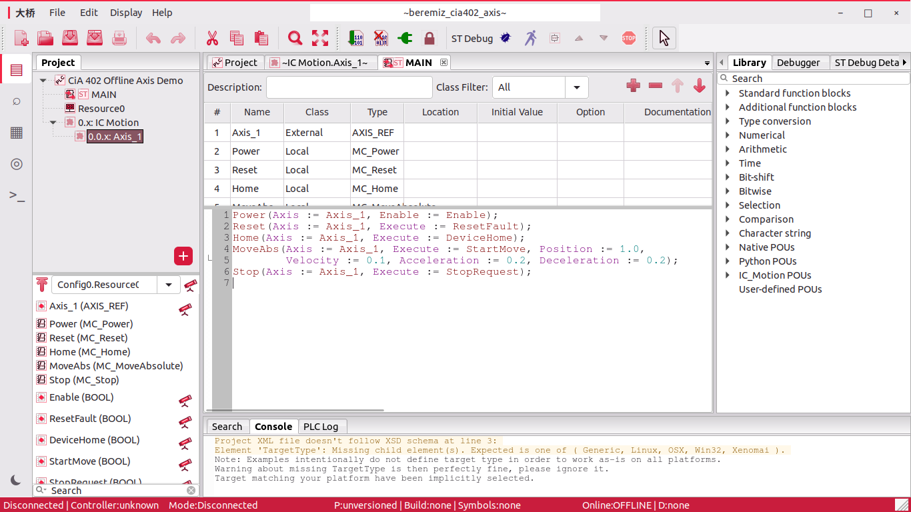
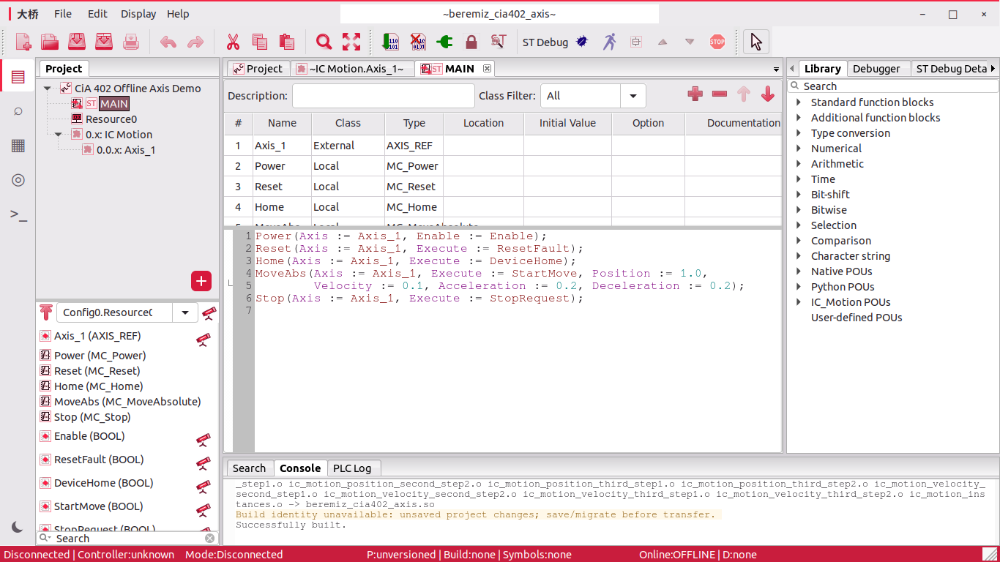

用途：通过模拟设备目录和独立实轴节点演示映射、CiA 402 配置及离线构建。当前状态：两工程 V0.0.17 Clean Build 与真实 IDE 页面 PASS；映射过程映像夹具 PASS；实轴仿真和实机 SKIP。正式包启动器的映射页路径缺陷已标明。

# 06 设备映射与 CiA 402

| 项目 | 可复核值 |
| --- | --- |
| 所需 IDE | V0.0.17 Linux amd64 本地候选；包源码 `8f743aa19cc49012b5cfec38a49d15d95fb9facd` |
| 映射工程 | [`examples/v0.0.17/beremiz_device_mapping/`](https://github.com/Leo-Hassan/ic-motion-tutorial/tree/main/examples/v0.0.17/beremiz_device_mapping)，入口 `beremiz.xml` |
| CiA 402 工程 | [`examples/v0.0.17/beremiz_cia402_axis/`](https://github.com/Leo-Hassan/ic-motion-tutorial/tree/main/examples/v0.0.17/beremiz_cia402_axis)，入口 `beremiz.xml` |
| 关键 POU / 资源 | 映射：`plc.xml/MAIN`、`device-catalog.json`、`IC Motion@ic_motion/Mapping@DeviceMapping`；实轴：`plc.xml/MAIN`、`IC Motion@ic_motion/Axis_1@Cia402RealAxis/confnode.xml` |
| 源码提交 | 两个工程均来自 `ic-beremiz-motion` `0867ececc3224815e4f0aae07b76b9581f70cfe4`，分别复制 7 和 6 个跟踪文件 |
| 验证状态 | 两工程包内 Clean Build 和真实 GUI Build PASS；映射生成周期、工作流、保存工程过程映像 3 项 CTest PASS；实轴仿真与物理 I/O SKIP |

## 映射工程：查看四个通道

1. 核对[版本](../versions.md)后在 IDE 打开 `beremiz_device_mapping/`。V0.0.17 正式启动器打开 `Mapping` 页会因缺少包内 `ic_device_catalog` Python 路径报错；本版请在教程根目录用下方的**离线打开**脚本，它只启动包内 GUI，不创建 Runtime 隧道，也不连接设备。脚本核对包版本并补齐包内模块和校验库路径。

   ```sh
   ./scripts/open_mapping_offline.sh <V0.0.17包目录> \
     examples/v0.0.17/beremiz_device_mapping V0.0.17
   ```

2. 展开 **IC Motion → Mapping**，双击节点。核对标题 `Offline editing: no Connect, Transfer, Run or SDO action`，设备 `Simulated-IO` 的四行：`Output bool`（0x7010:01）、`Output value`（0x607A:00）、`Input bool`（0x6000:01）、`Input value`（0x6064:00）。表中 PDO/对象索引来自内置模拟快照，**不是**本机扫描所得的真实 ESI。
3. 选择一行只读查看现有 `CONFIG0.*` 变量绑定和方向；本章不修改绑定。`Save mapping` 用于在临时工程副本保存修改，`Compare offline snapshot…` 只读取用户选择的 JSON。没有真实设备快照时不要猜测通道方向、类型、位宽或所有者。
4. 按 `F11` 构建，或运行 `scripts/clean_build.sh <V0.0.17包目录> examples/v0.0.17/beremiz_device_mapping V0.0.17`。本工程的 `MAIN` 只计算两个模拟输出，不会触发任何物理输出。



*图 1：步骤 2；真实 V0.0.17 包内 IDE 的四行模拟映射表，窗口底栏 `Online:OFFLINE`。*

```iecst
(* 在模拟输入映像中取反 BOOL，写回模拟输出变量。 *)
OutputBool := NOT InputBool;
(* 为 DINT 输入加 17；本章只验证生成的离线过程映像。 *)
OutputValue := InputValue + 17;
```



*图 2：步骤 4；真实 IDE Console 显示 `Successfully built.`，同时提示旧工程无 manifest。*

映射工程 Clean Build 的 `project.so` SHA-256 为 `e43ec09b46158754af6f3158ad99a87ff8546587b9d024a9d1bf13ee2d380603`，变量表为 `3b7fcd0f6c7f64522261d3326c0263b3f6bc0520c3ae72e72ac2c59f9e61e237`。同源码的 `MAP_P01C_GENERATED_CYCLE`、`MAP_P01D_WORKFLOW`、`MAP_P01D_BEREMIZ_CLEAN_BUILD` 离线测试 3/3 PASS，后者对保存工程执行模拟过程映像验证；这不是现场 PDO 或设备扫描。

## CiA 402 工程：检查实轴占位配置

5. 在另一个离线 IDE 窗口打开 `beremiz_cia402_axis/`。展开 **IC Motion → Axis_1**，先看 **Commissioning** 的 `state=OFFLINE`，再切到 **Config** 核对 `Mode=CSP`、`CountsPerUnit=1000`、位置 -10..10、最大速度 0.1、PLC/Bus 周期 1 ms、`TransportChannel=1`。这些都是**示例占位值**，不可套用到真实 IS620N、机械零位或驱动器参数。
6. 打开 `MAIN`，逐行查看 `MC_Power`、`MC_Reset`、`MC_Home`、`MC_MoveAbsolute`、`MC_Stop` 的独立请求变量。在离线状态按 `F11` 构建；或运行 `scripts/clean_build.sh <V0.0.17包目录> examples/v0.0.17/beremiz_cia402_axis V0.0.17`。本工程含 `Cia402RealAxis`，不适用只接受 `VirtualAxis` 的 `Ctrl+Alt+M` 仿真入口。



*图 3：步骤 5；轴类型、示例边界和 `OFFLINE` 质量同时可见。*



*图 4：步骤 5；配置页显示 CSP、缩放、位置和速度字段。*



*图 5：步骤 6；`MAIN` 中五个块调用和工程树的 `Axis_1` 同屏显示。*



*图 6：步骤 6；IDE Console 显示 `Successfully built.`。该 GUI 临时副本在查看配置后被标为 unsaved，身份提示不能替代包内 Clean Build 哈希。*

```iecst
(* 这些 BOOL 初值为 FALSE，本章仅做离线构建。 *)
Power(Axis := Axis_1, Enable := Enable);
Reset(Axis := Axis_1, Execute := ResetFault);
(* SoftwareZero 只表示逻辑零点，不等于物理回零。 *)
Home(Axis := Axis_1, Execute := DeviceHome);
MoveAbs(Axis := Axis_1, Execute := StartMove, Position := 1.0,
        Velocity := 0.1, Acceleration := 0.2, Deceleration := 0.2);
Stop(Axis := Axis_1, Execute := StopRequest);
```

此工程 Clean Build 的 SO SHA-256 为 `fcd539f319107916186b9e6fc267a76a10b688291099b959f4c829a52be7cec5`，变量表为 `dbf04d33b449df0b82230966a644b0bd4f6290b53a32b0add1655b16ad8d9900`。构建成功只说明 ST 与离线 C 扩展能编译，**没有**设备 PDO、模式、状态字、位置反馈或电机运动证据。

| 现象 | 核对位置 |
| --- | --- |
| 打开 Mapping 页提示 `No module named ic_device_catalog` | V0.0.17 启动器缺 Python 模块路径；使用本章离线打开脚本，核对进程仍指向同一 V0.0.17 包。 |
| 映射保存拒绝 | 核对方向、类型、单一输出所有者、位区间和快照身份；未知值保留 unknown，不填猜测值。 |
| `Build identity unavailable` | 两个上游旧工程无 manifest；只可做离线构建，不能据此 Transfer。 |
| 实轴仿真入口拒绝 | `Ctrl+Alt+M` 仅接受 LOCAL 虚轴；本章对实轴节点仅执行离线 Build。 |
| 将 `SoftwareZero` 当作物理 Home | 它只是逻辑零点；实际回零、安全输入和参数须另行现场验收。 |

**验证范围：**真实 V0.0.17 IDE 编辑页与离线构建、模拟映射过程映像；没有现场 ESI/PDO 比对、连接、Transfer、Run、Force、SDO 写入、实轴运动或功能安全验收。
