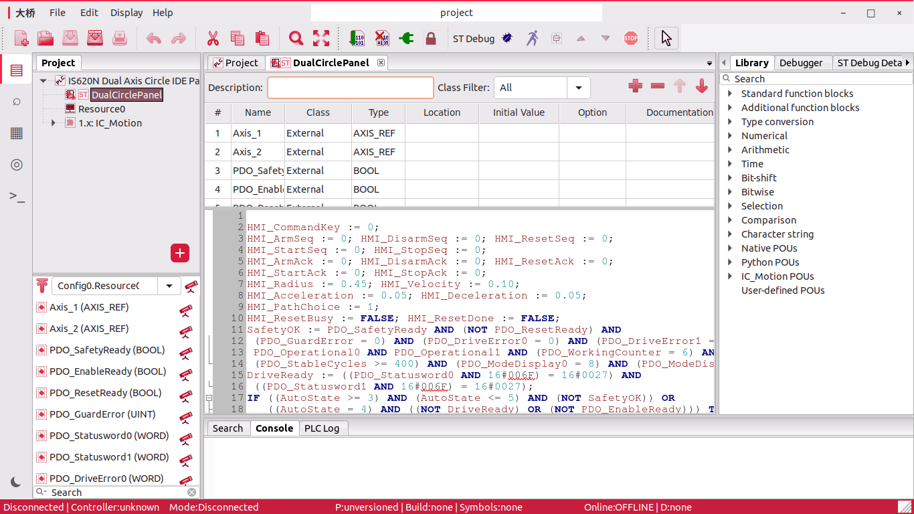
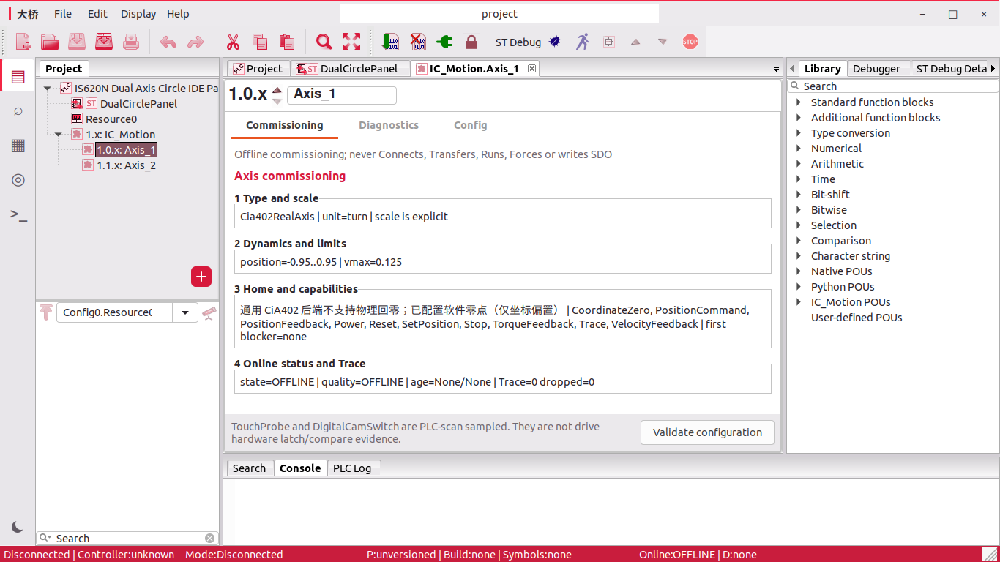
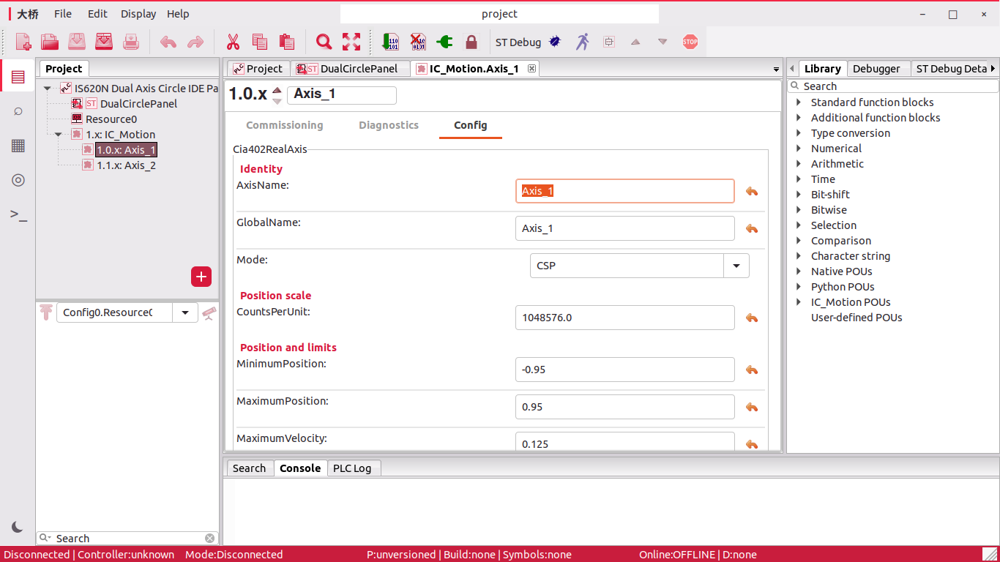
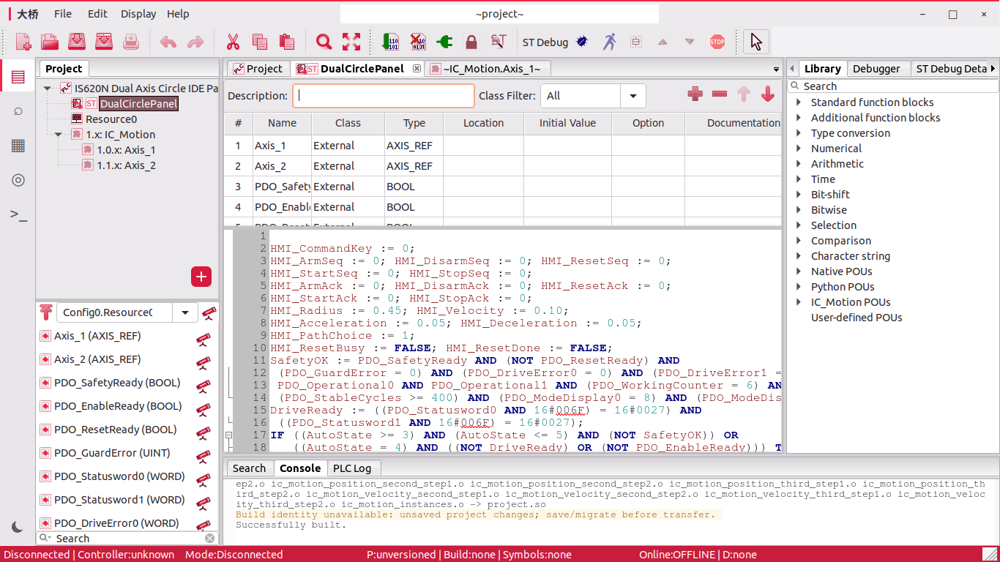

用途：说明 IS620N 双实轴工程在大桥 IDE 中的离线配置与交叉构建。当前状态：V0.0.17 包内 Clean Build、真实 GUI 构建和静态配置核对 PASS；仿真、板端部署及实机运动 SKIP。

# 07 IS620N 实轴工程的离线配置与构建

| 项目 | 可复核值 |
| --- | --- |
| 所需 IDE | V0.0.17 Linux amd64 本地候选；包源码 `8f743aa19cc49012b5cfec38a49d15d95fb9facd` |
| 可打开工程 | [`examples/v0.0.17/is620n_dual_circle_offline/`](https://github.com/Leo-Hassan/ic-motion-tutorial/tree/main/examples/v0.0.17/is620n_dual_circle_offline)，入口 `beremiz.xml` |
| 关键 POU / 资源 | `plc.xml/DualCirclePanel`，`Config0/Resource0/MotionTask`；`IC_Motion@ic_motion/Axis_1@Cia402RealAxis/confnode.xml` 和 `Axis_2`；`IS620N_Dual_PDO@c_ext/cfile.xml`、`confnode.xml` |
| 源码提交 | `IGH_RK_1.6-master` `e6308f19cafe6c591e2dea0c8ba92b0349b746be`，原路径 `beremiz_projects/is620n_cia402_dual_circle_online/`；11 个跟踪工程文件，两个 XML 路径字段经脱敏修改 |
| 当前验证 | 配置静态核对 PASS；包内 AArch64 Clean Build PASS；同源临时副本真实 IDE `F11` Build PASS，SO 与变量表逐字节一致；离线仿真/板端 SKIP |

## 准备与操作步骤

本例保留真实的双轴 CSP 程序和 C extension，但移除了原工程报告、PSK、构建物与本机绝对路径。它是**离线教学副本**：构建成功只表示编译和链接可完成，生成 SO 不可用于 Transfer。读者须自行准备与目标架构匹配的 IgH AArch64 SDK（含 `include/ecrt.h`、`lib/libethercat.so`）及 `aarch64-buildroot-linux-gnu-gcc`；本站不随附现场主站或 SDK。

1. 核对 V0.0.17 包的 `bin/ic-platform --version`，应为 `Industrial Control Platform V0.0.17`。在教程仓库根运行 `python3 scripts/verify_is620n_offline_config.py examples/v0.0.17/is620n_dual_circle_offline`，确认 1 ms、双 CSP 通道 1/2、每轴软件零点 ±0.95 转、缩放 1,048,576 counts/转。
2. 用下方 `open_is620n_offline.sh` 在**临时副本**打开真实 V0.0.17 IDE，保持底部 `Online:OFFLINE`。脚本把 `${IC_TUTORIAL_IGH_SDK}` 仅在临时工程内替换为调用者路径，并把交叉编译器放入构建 PATH；退出时删除临时副本。展开工程树 **IC_Motion**，可见 Axis_1、Axis_2。双击 `DualCirclePanel`，定位 ST 的固定半径 0.45、速度 0.10、加减速度 0.05 和 `SafetyOK` 门控。
3. 双击 Axis_1，先看 **Commissioning** 的 `state=OFFLINE`、`quality=OFFLINE`，再切换 **Config**，确认 `Mode=CSP`、`CountsPerUnit=1048576.0`、位置 `-0.95..0.95`、最大速度 `0.125`。Axis_2 的配置文件对应通道 2，数值相同。该界面是离线配置，不能显示驱动实际反馈。
4. 在临时工程窗口按 `F11`，等 Console 出现 `Successfully built.`；或者运行下方 `clean_build_is620n_offline.sh` 做包内 CLI Clean Build。首次运行需编译真实 C/C++ 扩展，耗时可能较长。两条路径均只编译/链接，不会连接 Runtime。不要在本教学副本上使用 Connect、Transfer 或 Run。

```sh
./scripts/open_is620n_offline.sh \
  /path/to/ic-platform-V0.0.17-linux-amd64 \
  examples/v0.0.17/is620n_dual_circle_offline \
  /path/to/igh-aarch64-sdk \
  /path/to/aarch64-cross-toolchain/bin

./scripts/clean_build_is620n_offline.sh \
  /path/to/ic-platform-V0.0.17-linux-amd64 \
  examples/v0.0.17/is620n_dual_circle_offline \
  /path/to/igh-aarch64-sdk \
  /path/to/aarch64-cross-toolchain/bin
```



*图 1：步骤 2；真实 V0.0.17 IDE 的 `DualCirclePanel` ST、双轴工程树和离线状态。*



*图 2：步骤 3；Axis_1 Commissioning 明示 `state=OFFLINE`，不代表驱动已连接。*



*图 3：步骤 3；Axis_1 Config 显示 CSP、counts/转、软件位置限位和最大速度。*

## 关键 ST 与资源

下列片段来自 `dual_circle_panel.st` 对应的 `plc.xml/DualCirclePanel`。中文注释解释离线审阅重点；完整可构建代码以工程文件为准。**不要把固定轨迹参数当成新的实机运行授权。**

```iecst
(* 固定轨迹参数；HMI 字段在此工程中只作状态展示。 *)
HMI_Radius := 0.45;
HMI_Velocity := 0.10;
HMI_Acceleration := 0.05;
HMI_Deceleration := 0.05;

(* 只有过程映像、安全门、工作计数、稳定周期及 CSP 模式同时满足才许可。 *)
SafetyOK := PDO_SafetyReady AND (NOT PDO_ResetReady) AND
            (PDO_GuardError = 0) AND
            (PDO_DriveError0 = 0) AND (PDO_DriveError1 = 0) AND
            PDO_Operational0 AND PDO_Operational1 AND
            (PDO_WorkingCounter = 6) AND
            (PDO_StableCycles >= 400) AND
            (PDO_ModeDisplay0 = 8) AND (PDO_ModeDisplay1 = 8);

(* 两轴共用圆插补块；这些值仅在真实运行许可后才会成为运动指令。 *)
Circle(AxisX := Axis_1, AxisY := Axis_2, Execute := CircleExecute,
       CenterX := -0.45, CenterY := 0.0,
       EndPositionX := 0.0, EndPositionY := 0.0,
       PathChoice := 1, Velocity := 0.10,
       Acceleration := 0.05, Deceleration := 0.05);
```

两个 `Cia402RealAxis` 的 `PeriodSource=PLCTask`、PLC/Bus 周期均为 `0.001` s，通道分别为 1/2。根 `beremiz.xml` 的 `EtherCATMasterTaskPeriod=1ms` 与 `plc.xml` 的 `MotionTask=T#1ms` 对齐。`IS620N_Dual_PDO@c_ext/confnode.xml` 保留 `-D_GNU_SOURCE -pthread`，IgH 头文件与库路径由教学脚本提供；主站实现仍在独立上游模块，本站没有创建或复制 EtherCAT 主站。

## 预期结果、错误与验证范围



*图 4：步骤 4；真实 IDE Console 显示 `Successfully built.`；`Build identity unavailable: unsaved project changes` 提示不能用此副本部署。*

本次 CLI 和 GUI 构建的 `project.so` SHA-256 都为 `e85cd37c6620d23b92e26022ba5bce5d4bc58daa959a983ce96c8d7f97f25ded`，`VARIABLES.csv` 都为 `843cd871ebd5ab5e58075bb7293d061cbda2f608db5859aa5b08247af1298fa7`。GUI 产物经 `file` 确认为 AArch64 共享对象，`readelf -Ws` 未见 `CPU_ZERO`、`CPU_SET`、`CPU_ISSET` 或 `__atomic` 未定义符号。两条构建都提示无可部署身份；这些哈希只证明本机离线编译结果一致。

| 现象 | 检查位置 |
| --- | --- |
| 直接打开源码目录后找不到 `-lethercat` | V0.0.17 的 `LDFLAGS` 不自动展开 `${IC_TUTORIAL_IGH_SDK}`；用脚本在临时副本替换路径，确认 IgH SDK 的 AArch64 库和交叉编译器匹配。首次直接构建已真实报过此错。 |
| `No module named click` | 某些交叉工具链目录带有不兼容的 `python3`；教学脚本在 PATH 首位固定调用前的主机 Python。首次脚本尝试已真实遇到此错。 |
| `Build identity unavailable` | 原工程没有可用 manifest，或 GUI 临时副本存在未保存的视图更改；仅允许离线构建，不能当作 Transfer 条件。 |
| 轴页显示 `OFFLINE` | 这是本章预期；没有设备状态字、PDO 反馈或现场限位验收。不要把软件配置页值当作实时反馈。 |
| 想执行本工程仿真 | 双轴工程依赖真实 PDO/DC 与 IgH 适配；当前没有适用的独立离线过程映像仿真，记为 SKIP，不用历史实机结果代替。 |

**验证范围：**静态工程配置、真实 IDE 界面和包内 AArch64 交叉 Clean Build。无当前版本板端连接、Stop、Transfer、Run、Force、SDO 写入、驱动参数修改或电机运动；不宣称硬实时、机械安全或实机验收。
