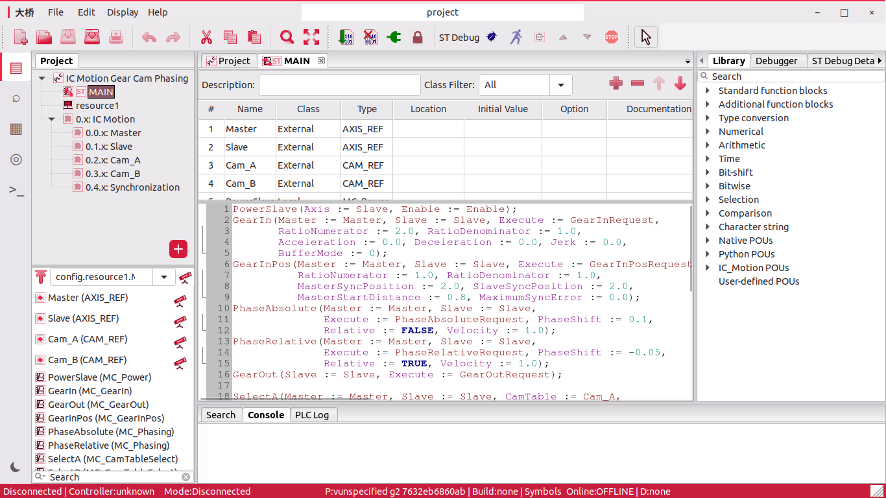
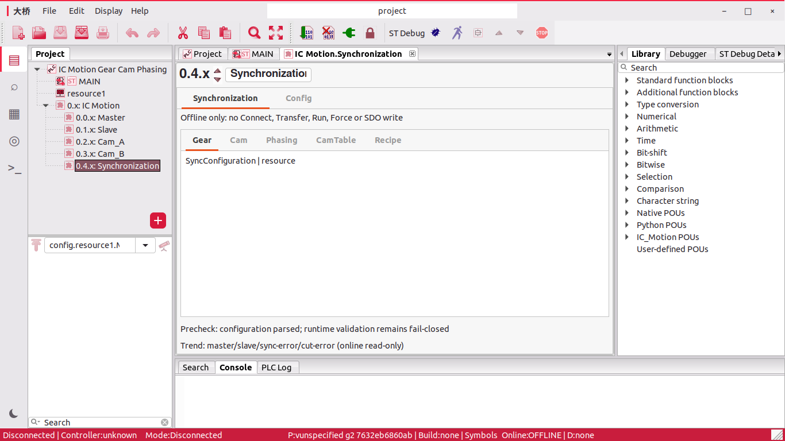
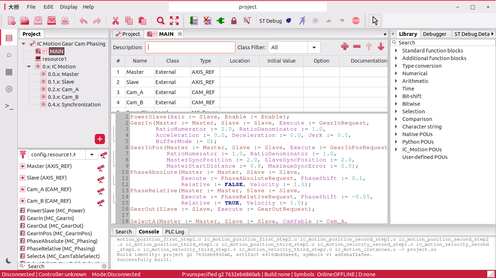

用途：指导读者在真实 V0.0.17 大桥 IDE 中查看并验证电子齿轮、带位置同步的齿轮和相位调整。当前状态：包内 Clean Build、真实 GUI Build、保存工程离线仿真 PASS；现场同步 SKIP。

# 08 电子齿轮与相位调整

| 项目 | 可复核值 |
| --- | --- |
| 所需 IDE | V0.0.17 Linux amd64 本地候选；包源码 `8f743aa19cc49012b5cfec38a49d15d95fb9facd` |
| 可打开工程 | [`examples/v0.0.17/beremiz_sync_gear_cam/`](https://github.com/Leo-Hassan/ic-motion-tutorial/tree/main/examples/v0.0.17/beremiz_sync_gear_cam)，入口 `beremiz.xml` |
| 关键 POU / 资源 | `plc.xml/MAIN`；`IC Motion@ic_motion/Master@EncoderAxis/confnode.xml`、`Slave@VirtualAxis/confnode.xml`、`Synchronization@SyncConfiguration/confnode.xml` |
| 源码提交 | `ic-beremiz-motion` `0867ececc3224815e4f0aae07b76b9581f70cfe4`，原路径 `examples/beremiz_sync_gear_cam/`；15 个跟踪文件原样复制 |
| 本次状态 | 包内两次 Clean Build 和保存工程仿真 PASS；真实 IDE Build PASS；主从轴均无现场连接，实轴同步 SKIP |

## 操作步骤

1. 核对本机 V0.0.17 包的 `bin/ic-platform --version` 输出 `Industrial Control Platform V0.0.17`。将本例工程复制到临时目录，在包内 IDE 中打开该副本；不要把 `build/` 放回教程工程。确认底部 `Online:OFFLINE`。
2. 展开工程树 `IC Motion`。双击 `MAIN`，在 ST 前半部分查看 `GearIn`、`GearInPos`、两个 `MC_Phasing` 实例和 `GearOut`。`Master` 是 `EncoderAxis`，`SourceMode=Simulation`、每次扫描增加 1 count、100 counts/单位；`Slave` 是 `VirtualAxis`，不映射硬件。
3. 双击 `Synchronization`，确认页底显示 `Precheck: configuration parsed`。在其 `Config` 页或 `Synchronization@SyncConfiguration/confnode.xml` 中核对 `gear → gear-position → phase-absolute → phase-relative` 的依赖。回到 `MAIN`：`GearIn` 比率为 2:1；`GearInPos` 使用 1:1、主从同步位置 2.0 和主轴起始距离 0.8；绝对相位为 +0.1，相对相位为 -0.05。`Execute` 请求变量由测试夹具按次序激发，单纯打开工程不会自动运动。
4. 在尚未编辑的临时副本按工具栏 Build 或 `F11`，Console 等待 `Successfully built.`。离线复现两次 Clean Build 和保存工程仿真：

```sh
./scripts/clean_build.sh /path/to/ic-platform-V0.0.17-linux-amd64 \
  examples/v0.0.17/beremiz_sync_gear_cam V0.0.17
./scripts/verify_sync_gear_cam.sh /path/to/ic-platform-V0.0.17-linux-amd64 \
  examples/v0.0.17/beremiz_sync_gear_cam
```



*图 1：步骤 2；真实 V0.0.17 IDE 显示 `MAIN` 中的比率、同步位置、相位和 GearOut。*



*图 2：步骤 3；真实 IDE 的 Synchronization 资源页显示离线预检已解析；具体依赖记录在同资源的 `confnode.xml`。*

## 带注释的 ST 关键片段

以下是 `plc.xml/MAIN` 中对应调用的摘录，中文注释解释请求与交接；完整声明和所有块调用以工程文件为准。

```iecst
(* 先给虚拟从轴上电；主轴是本地模拟编码器。 *)
PowerSlave(Axis := Slave, Enable := Enable);

(* 请求边沿后以 2:1 比率跟随主轴。 *)
GearIn(Master := Master, Slave := Slave, Execute := GearInRequest,
       RatioNumerator := 2.0, RatioDenominator := 1.0,
       Acceleration := 0.0, Deceleration := 0.0, Jerk := 0.0,
       BufferMode := 0);

(* 在主从位置 2.0 处接入；起始距离 0.8 用于同步过渡。 *)
GearInPos(Master := Master, Slave := Slave, Execute := GearInPosRequest,
          RatioNumerator := 1.0, RatioDenominator := 1.0,
          MasterSyncPosition := 2.0, SlaveSyncPosition := 2.0,
          MasterStartDistance := 0.8, MaximumSyncError := 0.0);

(* 分别验证绝对 +0.1 和相对 -0.05 的相位命令。 *)
PhaseAbsolute(Master := Master, Slave := Slave,
              Execute := PhaseAbsoluteRequest, PhaseShift := 0.1,
              Relative := FALSE, Velocity := 1.0);
PhaseRelative(Master := Master, Slave := Slave,
              Execute := PhaseRelativeRequest, PhaseShift := -0.05,
              Relative := TRUE, Velocity := 1.0);
GearOut(Slave := Slave, Execute := GearOutRequest);
```

## 预期结果与验证范围



*图 3：步骤 4；真实 V0.0.17 IDE 的工程树、`MAIN` 编辑位置和 Console `Successfully built.`；底栏仍为离线。*

包内保存工程测试 2/2 PASS，包括生成、保存、重开、另存、备份、恢复、两次 Clean Build 和 C 仿真夹具。仿真报告 `GearIn/Out GearInPos Phasing absolute/relative` PASS；它在本地主机加载同工程生成的 `project.so`，没有物理驱动。单独 CLI Clean Build 和测试中的两次 Build 得到相同 SO SHA-256 `e416dbd9aee8aae7f9568970f697301c89d96cbe74eedcbeca1afb4619f5b9bd`，变量表 SHA-256 `adfebaf2a5ee9129c777d96d7875594e37f957b867d291aced09f4f8f591b97c`。GUI Console 显示同一工件身份短哈希；完整 CLI 哈希不由截图单独证明。

| 现象 | 检查位置 |
| --- | --- |
| `SourceMode` 不是 `Simulation` | 检查 `Master@EncoderAxis/confnode.xml`；本例预期是模拟编码器，不应要求 EtherCAT。 |
| GearIn 后从轴不跟随 | 核对 `PowerSlave.Enable`、`GearInRequest` 请求边沿、主轴计数增量和 `GearOutRequest`；查看块的 `Done/Busy/Error`。 |
| GearInPos 无法进入同步 | 核对 `MasterSyncPosition=2.0`、`SlaveSyncPosition=2.0`、`MasterStartDistance=0.8` 与请求顺序；本例仿真夹具覆盖该路径。 |
| 打开编辑器后立即 Build 弹出 `wxYield called recursively` | 本次 V0.0.17 GUI 初次真实遇到；关闭异常对话框、重启 IDE、等工程加载完成后从**未编辑**副本重试，第二次 GUI Build PASS。首次异常记录在 `TEST_REPORT.md`，不能计为一次成功。 |

**验证范围：**本机 V0.0.17 包内工具链、真实 IDE 界面、保存工程离线软件仿真。没有接入生产 Runtime、PDO、驱动或电机；不代表实轴电子齿轮的时序、限位或安全验收。[下一篇：电子凸轮](09-electronic-cam.md)。
