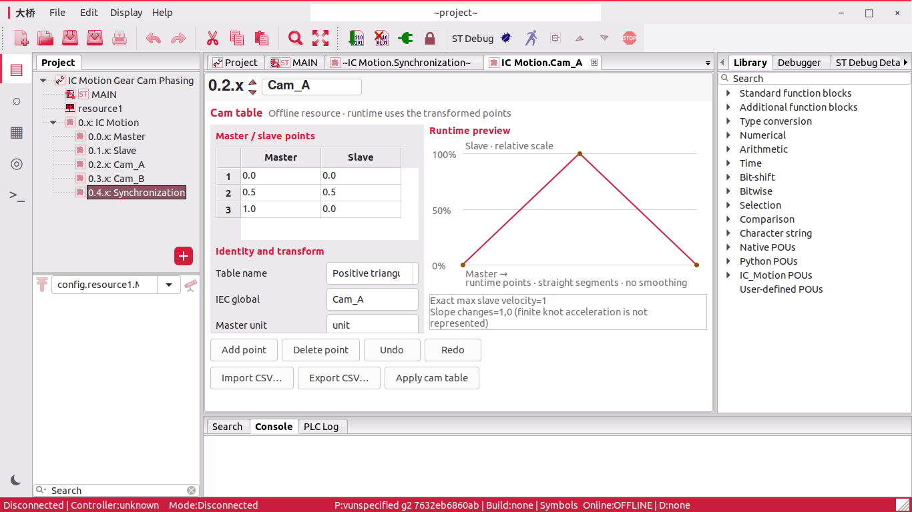
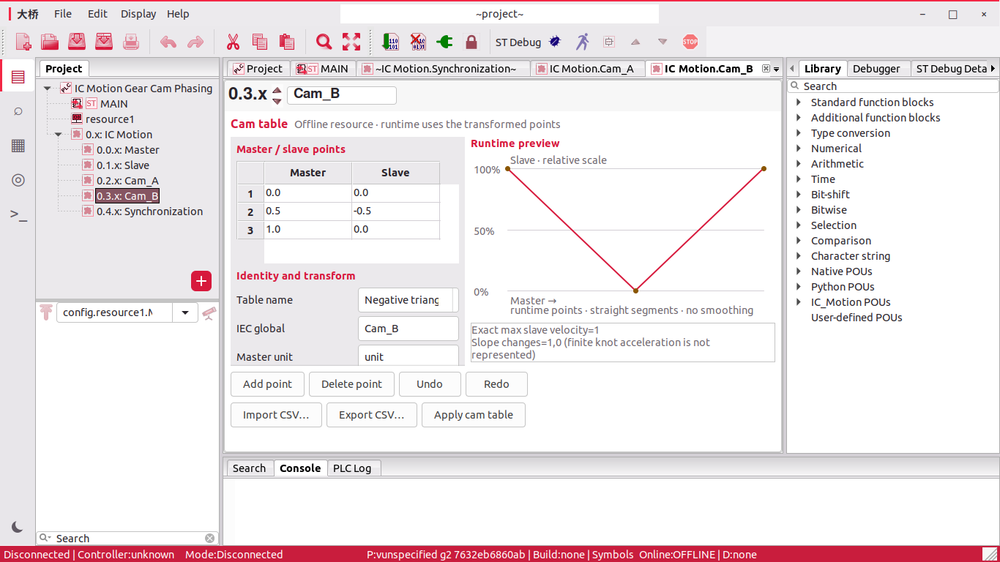
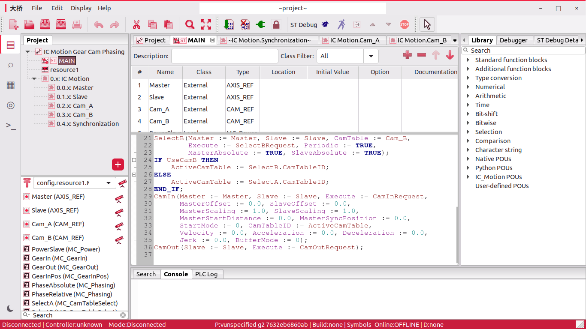

用途：指导读者在 V0.0.17 大桥 IDE 中查看双凸轮表、切换与解耦。当前状态：与案例 08 共用工程、包内 Clean Build 与保存工程离线仿真 PASS；实轴凸轮 SKIP。

# 09 电子凸轮与表切换

| 项目 | 可复核值 |
| --- | --- |
| 所需 IDE | V0.0.17 Linux amd64 本地候选；包源码 `8f743aa19cc49012b5cfec38a49d15d95fb9facd` |
| 可打开工程 | [`examples/v0.0.17/beremiz_sync_gear_cam/`](https://github.com/Leo-Hassan/ic-motion-tutorial/tree/main/examples/v0.0.17/beremiz_sync_gear_cam)，入口 `beremiz.xml`；与案例 08 是同一份工程 |
| 关键 POU / 资源 | `plc.xml/MAIN`；`IC Motion@ic_motion/Cam_A@CamTable/confnode.xml`、`Cam_B@CamTable/confnode.xml`、`Synchronization@SyncConfiguration/confnode.xml` |
| 源码提交 | `ic-beremiz-motion` `0867ececc3224815e4f0aae07b76b9581f70cfe4`，原路径 `examples/beremiz_sync_gear_cam/` |
| 本次状态 | 包内两次 Clean Build、保存工程仿真与真实 GUI Build PASS；凸轮真实设备运行 SKIP |

## 操作步骤

1. 按[案例 08](08-electronic-gear.md)核对 IDE 版本并打开同一工程的临时副本。展开 `IC Motion`，先双击 `Cam_A`。三点 `(0,0) → (0.5,0.5) → (1,0)` 在表格与预览中形成正三角形；主轴周期为 1 单位。
2. 双击 `Cam_B`。确认三点 `(0,0) → (0.5,-0.5) → (1,0)`，预览为负三角形。编辑器允许改点、CSV 导入/导出与 `Apply cam table`；本章只检查已保存表，不在教程原工程中改点。
3. 双击 `MAIN`，找到两个 `MC_CamTableSelect`、`UseCamB` 对 `ActiveCamTable` 的选择，以及 `MC_CamIn`、`MC_CamOut`。`SelectA`、`SelectB` 都设置 `Periodic=TRUE`，`CamIn` 接收选中的表 ID。`CamOutRequest` 请求时从轴退出凸轮耦合。
4. 在未修改的临时副本按 `F11`，确认 Console `Successfully built.`；执行 `./scripts/verify_sync_gear_cam.sh /path/to/ic-platform-V0.0.17-linux-amd64 examples/v0.0.17/beremiz_sync_gear_cam`。该脚本使用包内测试和工具链对**本章保存的工程**做两次 Clean Build、C 仿真及资源身份核对，通常需约两分钟。



*图 1：步骤 1；真实 V0.0.17 IDE 的 Cam_A 三点表和正三角形预览。*



*图 2：步骤 2；真实 IDE 的 Cam_B 三点表和负三角形预览。*



*图 3：步骤 3；真实 IDE 的 `MAIN`、资源树、表选择、CamIn 和 CamOut。*

## 带注释的 ST 关键片段

以下摘录对应 `plc.xml/MAIN`，保留原工程调用参数，注释说明表选择。完整 `MAIN` 及变量声明以工程源码为准。

```iecst
(* 两张表都注册为周期凸轮；请求信号分别触发选择。 *)
SelectA(Master := Master, Slave := Slave, CamTable := Cam_A,
        Execute := SelectARequest, Periodic := TRUE,
        MasterAbsolute := TRUE, SlaveAbsolute := TRUE);
SelectB(Master := Master, Slave := Slave, CamTable := Cam_B,
        Execute := SelectBRequest, Periodic := TRUE,
        MasterAbsolute := TRUE, SlaveAbsolute := TRUE);

(* 后续 CamIn 读取当前选中的表身份。 *)
IF UseCamB THEN
    ActiveCamTable := SelectB.CamTableID;
ELSE
    ActiveCamTable := SelectA.CamTableID;
END_IF;

(* 与主轴位置耦合；退出命令独立调用。 *)
CamIn(Master := Master, Slave := Slave, Execute := CamInRequest,
      MasterOffset := 0.0, SlaveOffset := 0.0,
      MasterScaling := 1.0, SlaveScaling := 1.0,
      MasterStartDistance := 0.0, MasterSyncPosition := 0.0,
      StartMode := 0, CamTableID := ActiveCamTable,
      Velocity := 0.0, Acceleration := 0.0, Deceleration := 0.0,
      Jerk := 0.0, BufferMode := 0);
CamOut(Slave := Slave, Execute := CamOutRequest);
```

## 预期结果、常见错误与验证范围

包内测试读取已保存工程，核对两张表的六个源点、`SyncConfiguration` 资源数，以及生成 C 的资源哈希。保存工程仿真输出 `CamSwitch/CamOut PASS`，涵盖正表、负表切换与退出；它和案例 08 的测试**共用同一次运行**，不重复计为另一次独立验收。构建摘要见[案例 08](08-electronic-gear.md)；本例 GUI 构建成功截图也共用该章图 3。

| 现象 | 检查位置 |
| --- | --- |
| Cam_A 或 Cam_B 预览与表格不一致 | 检查各自 `confnode.xml` 的 `Points`，并确认项目是已保存的原始副本。 |
| CamIn 使用错误表 | 检查 `UseCamB`、两次 `MC_CamTableSelect` 的请求和 `ActiveCamTable`；先选择表再触发 `CamInRequest`。 |
| 期望平滑曲线 | 当前资源编辑器预览标明直线段、无平滑；三点表会在尖角处改变斜率，不代表机械系统可直接跟随。 |
| `wxYield called recursively` GUI 异常 | 初次快速打开 `MAIN` 后立刻 Build 发生过；重启未编辑工程，等加载完成再 Build 已通过，见[案例 08 的记录](08-electronic-gear.md)。 |

**验证范围：**V0.0.17 包内工程、真实表编辑器、生成代码与本地主机软件仿真。未接入物理主轴、驱动或设备；未验证真实同步精度、加速度冲击或安全边界。[上一篇：电子齿轮](08-electronic-gear.md)。
