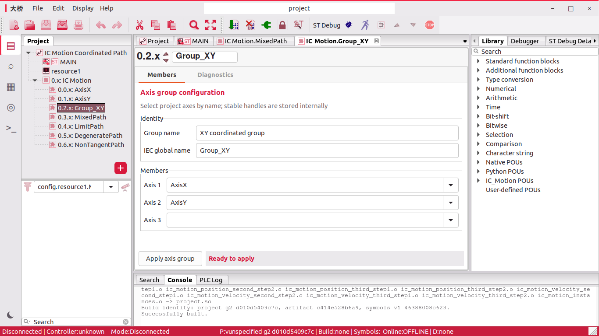
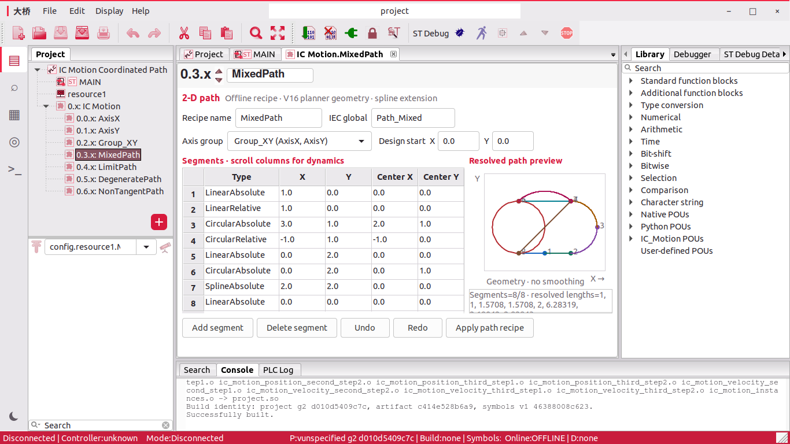
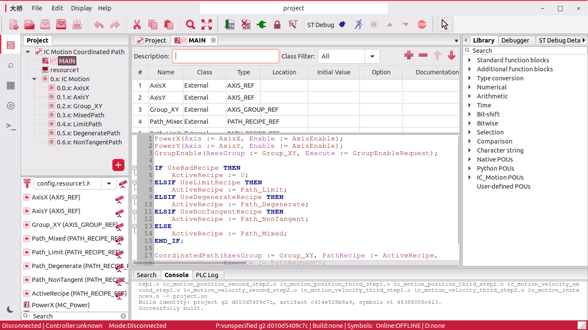
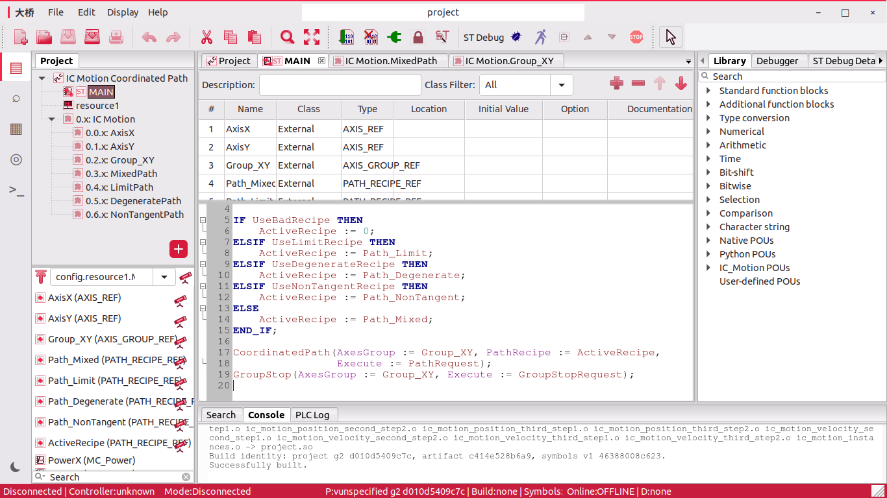

用途：指导读者在 V0.0.17 大桥 IDE 中查看 XY 轴组、八段二维路径及故障配方，并进行离线构建和仿真。当前状态：包内保存工程测试 2/2 PASS、真实 GUI Build PASS；现场路径 SKIP。

# 10 二维协调路径

| 项目 | 可复核值 |
| --- | --- |
| 所需 IDE | V0.0.17 Linux amd64 本地候选；包源码 `8f743aa19cc49012b5cfec38a49d15d95fb9facd` |
| 可打开工程 | [`examples/v0.0.17/beremiz_coordinated_path/`](https://github.com/Leo-Hassan/ic-motion-tutorial/tree/main/examples/v0.0.17/beremiz_coordinated_path)，入口 `beremiz.xml` |
| 关键 POU / 资源 | `plc.xml/MAIN`、`config/resource1/PathTask`；`IC Motion@ic_motion/Group_XY@AxisGroup/confnode.xml`、`MixedPath@PathRecipe/confnode.xml`、三个故障 PathRecipe |
| 源码提交 | `ic-beremiz-motion` `0867ececc3224815e4f0aae07b76b9581f70cfe4`，原路径 `examples/beremiz_coordinated_path/`，19 个跟踪文件原样复制 |
| 本次状态 | V0.0.17 包内保存工程两次 Clean Build、离线 C 仿真和真实 IDE GUI Build PASS；现场路径 SKIP |

## 操作步骤

1. 核对包内 `bin/ic-platform --version` 为 `Industrial Control Platform V0.0.17`。把本例工程复制到临时目录，用包内大桥 IDE 打开，确认底栏 `Online:OFFLINE`。本例 AxisX、AxisY 均为 `VirtualAxis`；只在主机上生成虚轴状态。
2. 展开工程树 `IC Motion`，双击 `Group_XY`。确认轴组的 `Axis1Handle=1`、`Axis2Handle=2`，它引用 AxisX/AxisY。两根轴的软位置范围均为 `-10..10`，最大速度为 5。此页是工程配置，不能证明硬件限位。
3. 双击 `MixedPath`，看八段顺序：绝对直线、相对直线、逆时针绝对圆弧、逆时针相对圆弧、绝对直线、顺时针整圆、绝对样条、绝对直线返回 `(0,0)`。第二段是 `BlendingHigh`，其余段分别按资源中的 `Aborting` 或 `Buffered` 模式执行。配方 XML 是可复核的完整坐标与速度参数。
4. 双击 `MAIN`，查看 `MC_Power`×2、`MC_GroupEnable`、`IC_CoordinatedPath` 与 `MC_GroupStop`。`UseBadRecipe`、`UseLimitRecipe`、`UseDegenerateRecipe`、`UseNonTangentRecipe` 依次选择非法、越界、退化和非切线配方，正常路径使用 `Path_Mixed`。测试夹具注入请求边沿，单纯打开工程不会自动开始路径。
5. 在未修改的临时副本按 `F11`，等 Console 显示 `Successfully built.`。在教程仓库根运行以下命令，在包内工具链中对本章**保存工程**做两次 Clean Build、生成代码检查和 C 仿真；它只在主机临时目录运行：

```sh
./scripts/clean_build.sh /path/to/ic-platform-V0.0.17-linux-amd64 \
  examples/v0.0.17/beremiz_coordinated_path V0.0.17
./scripts/verify_coordinated_path.sh /path/to/ic-platform-V0.0.17-linux-amd64 \
  examples/v0.0.17/beremiz_coordinated_path
```



*图 1：步骤 2；真实 V0.0.17 IDE 的 Group_XY 成员 AxisX/AxisY 和完整工程树。*



*图 2：步骤 3；真实 IDE 的八段 MixedPath 表与二维预览，显示直线、圆弧、样条和返回段。*



*图 3：步骤 4；真实 IDE 的 `MAIN` 资源声明、上电、使能及配方选择起始位置。*

## 带注释的 ST 与配方

`plc.xml/MAIN` 的关键片段如下，注释说明资源选择与命令交接；完整 POU 以工程文件为准。

```iecst
(* 两个虚轴上电并使能 XY 轴组。 *)
PowerX(Axis := AxisX, Enable := AxisEnable);
PowerY(Axis := AxisY, Enable := AxisEnable);
GroupEnable(AxesGroup := Group_XY, Execute := GroupEnableRequest);

(* 正常使用八段混合配方；其它配方只用于负向测试。 *)
IF UseBadRecipe THEN
    ActiveRecipe := 0;
ELSIF UseLimitRecipe THEN
    ActiveRecipe := Path_Limit;
ELSIF UseDegenerateRecipe THEN
    ActiveRecipe := Path_Degenerate;
ELSIF UseNonTangentRecipe THEN
    ActiveRecipe := Path_NonTangent;
ELSE
    ActiveRecipe := Path_Mixed;
END_IF;

(* PathRequest 由仿真夹具触发；Stop 请求撤销路径拥有权。 *)
CoordinatedPath(AxesGroup := Group_XY, PathRecipe := ActiveRecipe,
                Execute := PathRequest);
GroupStop(AxesGroup := Group_XY, Execute := GroupStopRequest);
```

`MixedPath@PathRecipe/confnode.xml` 中第一段从原点到 `(1,0)`，第二段相对位移 `(1,0)`；第三段逆时针绕 `(2,1)` 到 `(3,1)`；最后一段回到 `(0,0)`。资源还包含样条控制点 `(0.5,2.5)`、`(1.5,2.5)`。这些数值是软件配方，不是现场路径安全许可。

## 预期结果、常见错误和验证范围



*图 4：步骤 4～5；真实 IDE 的 `IC_CoordinatedPath`、`MC_GroupStop` 调用与 Console `Successfully built.`，底栏为 `Online:OFFLINE`。*

包内保存工程测试 2/2 PASS，先验证生成、保存、重开、另存、备份和恢复，再对本章工程执行两次 Clean Build 和 C 仿真。夹具跑完八段，`CurrentSegment=8`、`QueuedSegments=0`、`QueueExhausted=TRUE`，终点回到 `(0,0)`；还检查最大轮廓误差 `<0.01`、混合过渡、顺/逆时针圆弧及样条拱起。四类错误配方及反馈无效、GroupStop 在同一主机仿真 PASS。两次 Build 和真实 IDE GUI Build 的 SO SHA-256 为 `c414e528b6a9f3305ae861acd3263ccbfb1a8ee6576dc5be425f930729ad75df`，变量表为 `46388008c6236388a031412a22325b39f28be58626cac4562313043359509f07`。独立 CLI Clean Build 结果见 `TEST_REPORT.md`。

| 现象 | 检查位置 |
| --- | --- |
| XY 组未使能 | 检查 `AxisEnable`、两次 `MC_Power`、`GroupEnableRequest` 和 `Group_XY` 的轴句柄 1/2。 |
| 路径在限位处报错 | `Path_Limit` 目标 X=20，超过 AxisX 的 +10；它是故障注入配方，不是正常轨迹。 |
| 路径连续性错误 | `Path_NonTangent` 用于非切线衔接负向测试；切换回 `Path_Mixed` 验证正常路径。 |
| 误以为 `GroupStop` 是现场停机验收 | 此处只验证离线软件块的拥有权撤销与结束状态；没有驱动反馈或安全回路。 |

**验证范围：**V0.0.17 包内真实 IDE、虚轴保存工程、主机离线 C 仿真。无实轴控制、现场传感器、PDO/DC、板端操作或硬实时与机械安全验收。
