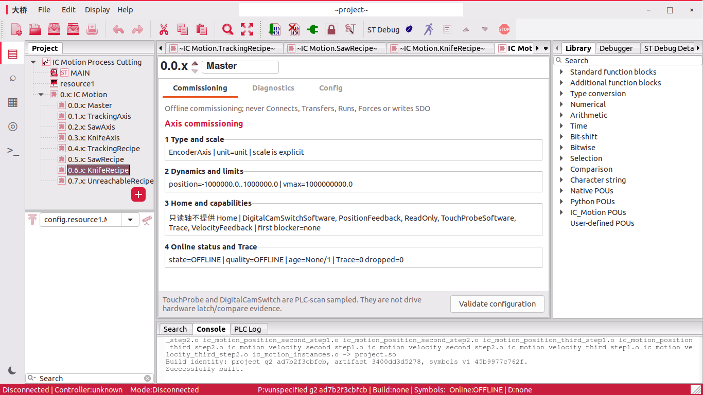
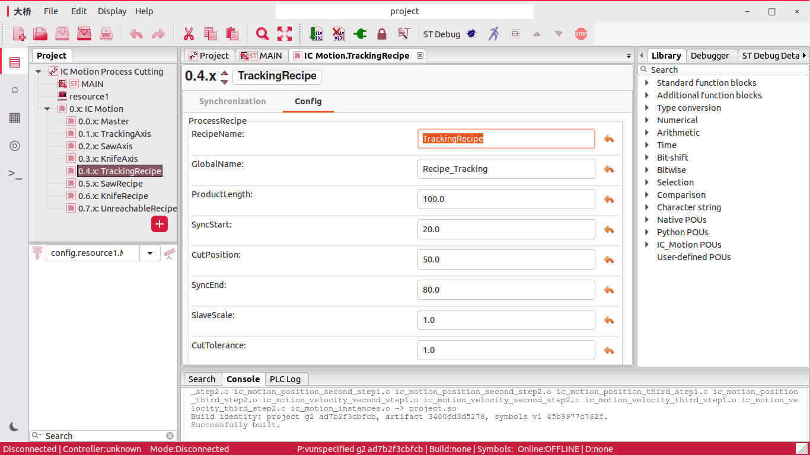
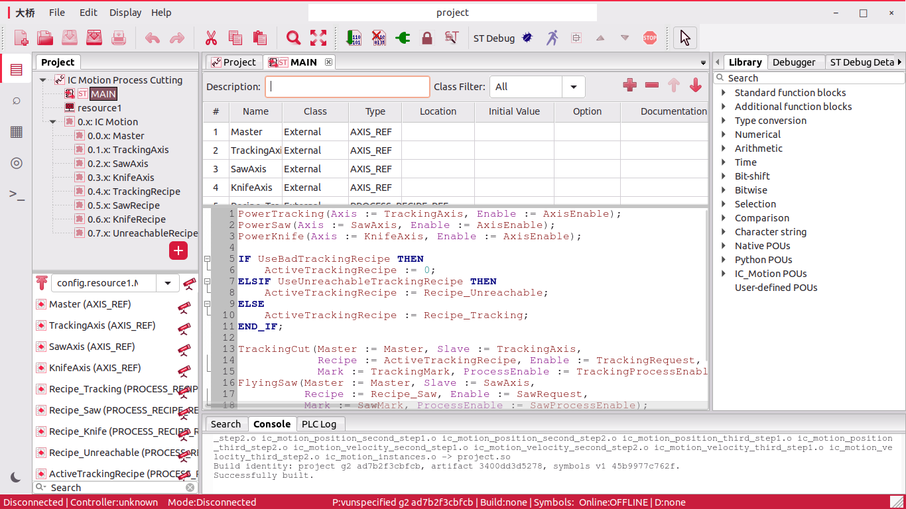
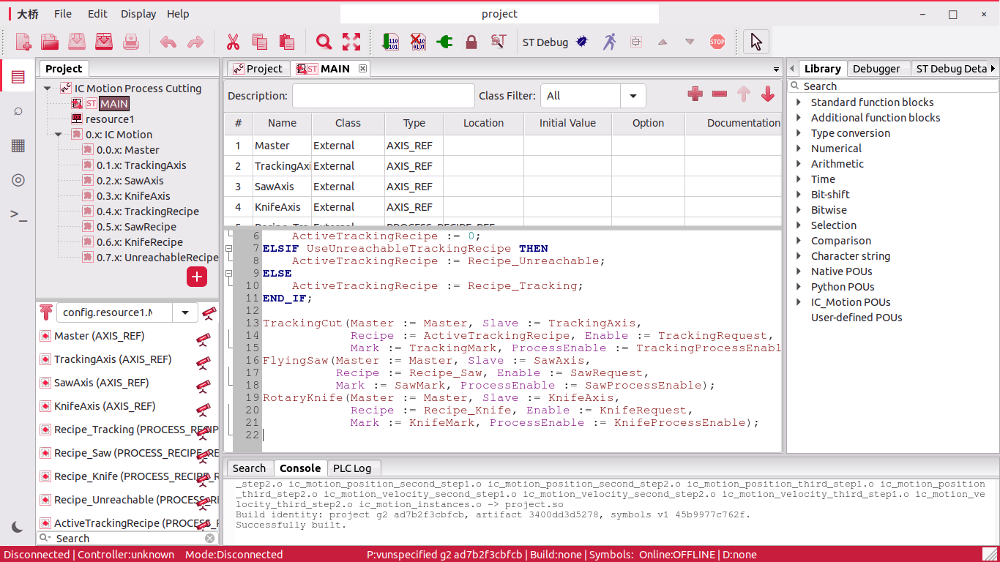

用途：指导读者用 V0.0.17 大桥 IDE 查看跟踪切的主从轴、工艺配方、ST 调用和离线仿真。当前状态：包内保存工程测试 2/2 PASS、真实 IDE Build PASS；实机切割 SKIP。

# 11 跟踪切

| 项目 | 可复核值 |
| --- | --- |
| 所需 IDE | V0.0.17 Linux amd64 本地候选；包源码 `8f743aa19cc49012b5cfec38a49d15d95fb9facd` |
| 可打开工程 | [`examples/v0.0.17/beremiz_process_cutting/`](https://github.com/Leo-Hassan/ic-motion-tutorial/tree/main/examples/v0.0.17/beremiz_process_cutting)，入口 `beremiz.xml` |
| 关键 POU / 资源 | `plc.xml/MAIN`、`config/resource1/ProcessTask`；`IC Motion@ic_motion/Master@EncoderAxis/confnode.xml`、`TrackingAxis@VirtualAxis/confnode.xml`、`TrackingRecipe@ProcessRecipe/confnode.xml`、`UnreachableRecipe@ProcessRecipe/confnode.xml` |
| 源码提交 | `ic-beremiz-motion` `0867ececc3224815e4f0aae07b76b9581f70cfe4`，原路径 `examples/beremiz_process_cutting/`；21 个跟踪文件原样复制 |
| 本次状态 | 与案例 12/13 共用一次包内保存工程仿真 2/2 PASS；真实 IDE GUI Build PASS；生产线及安全回路 SKIP |

## 操作步骤

1. 核对包内 `bin/ic-platform --version` 为 `Industrial Control Platform V0.0.17`。复制本例工程到临时目录，使用包内 IDE 打开；保持底栏 `Online:OFFLINE`。展开 `IC Motion`，可见 `Master`、三根虚轴和四张配方。
2. 双击 `Master`，核对 `SourceMode=Simulation`、初始计数 0、每扫描增量 1；双击 `TrackingAxis`，确认它是 VirtualAxis。这里没有真实输送线编码器或随动滑台。
3. 双击 `TrackingRecipe`，核对产品长度 100、同步起点 20、切点 50、同步结束 80、`SlaveScale=1`、误差容差 1、`MarkMode=true`。`UnreachableRecipe` 的 `SlaveScale=10000` 只用于负向错误测试。
4. 双击 `MAIN`，查看 `TrackingCut` 对 `Master`、`TrackingAxis`、`ActiveTrackingRecipe` 的调用。正常配方为 `Recipe_Tracking`；坏配方和不可达配方由两个布尔量选择。`TrackingRequest`、`TrackingMark`、`TrackingProcessEnable` 在包内夹具里有明确扫描时序，单纯打开工程不会自动切割。
5. 在未修改的临时副本按 `F11`，等 Console 显示 `Successfully built.`。在教程仓库根用包内脚本复现两次 Clean Build 与保存工程软件仿真：

```sh
./scripts/clean_build.sh /path/to/ic-platform-V0.0.17-linux-amd64 \
  examples/v0.0.17/beremiz_process_cutting V0.0.17
./scripts/verify_process_cutting.sh /path/to/ic-platform-V0.0.17-linux-amd64 \
  examples/v0.0.17/beremiz_process_cutting
```



*图 1：步骤 2；真实 V0.0.17 IDE 的 Master 页面明确显示 `state=OFFLINE`、`quality=OFFLINE`。*



*图 2：步骤 3；真实 V0.0.17 IDE 的跟踪切工艺配方与资源树。*



*图 3：步骤 4；真实 IDE 的 `MAIN` 中 `TrackingCut` 调用、FlyingSaw 起始行及资源树。*

## 带注释的 ST 关键片段

下列片段对应 `plc.xml/MAIN`；中文注释说明选择与许可，完整声明以工程文件为准。

```iecst
(* 模拟编码器主轴由资源页产生计数；跟踪滑台是虚轴。 *)
PowerTracking(Axis := TrackingAxis, Enable := AxisEnable);

(* 正常情况下选择 100 单位产品配方；两条分支供故障测试。 *)
IF UseBadTrackingRecipe THEN
    ActiveTrackingRecipe := 0;
ELSIF UseUnreachableTrackingRecipe THEN
    ActiveTrackingRecipe := Recipe_Unreachable;
ELSE
    ActiveTrackingRecipe := Recipe_Tracking;
END_IF;

(* Mark 为产品标记；ProcessEnable 控制切割许可。 *)
TrackingCut(Master := Master, Slave := TrackingAxis,
            Recipe := ActiveTrackingRecipe, Enable := TrackingRequest,
            Mark := TrackingMark, ProcessEnable := TrackingProcessEnable);
```

## 预期结果、常见错误与验证范围

包内保存工程测试 2/2 PASS，在模拟主轴每扫描增加 1 单位、每 100 单位一个产品、每产品相位 10 注入标记时，三种块各完成 5 个产品与 5 次 CutPermit；跟踪切 `MissedCount=0`、`DuplicateCount=0`、`OverLimitCount=0`、最大切点误差 `<=1`。夹具还注入坏配方、漏标、重复标记、禁止切割、跳产品、反向和不可达配方，检查 `FaultStopping`、许可撤销、滑台停止及执行器释放。两次包内 Clean Build、独立 CLI Build 和真实 GUI Build 的 SO SHA-256 都为 `3400dd3d527864775cc3d3ba43317092ce62df2eb1d05f66f9171a8b29dce01b`，变量表为 `45b9977c762f47c47df15e738c0964401b1cbd33d84ee05ba512a6866bb331b3`。这些均是软件结果，不是现场切割。

| 现象 | 检查位置 |
| --- | --- |
| `PROCESS_RECIPE` 错误 | 检查 `UseBadTrackingRecipe`；它会令 `ActiveTrackingRecipe=0`，是故障注入。 |
| 漏标或重复标记 | 核对标记边沿、每产品长度 100、`MarkMode=true` 和标记相位；软件夹具会将这两种情况计为故障。 |
| `CUTPERMIT` 一直为 0 | 检查 `TrackingProcessEnable`、同步窗口 20..80、请求使能及故障状态；不应在没有许可时假定刀具可动作。 |
| 误把离线计数当生产线测量 | `Master` 是模拟 EncoderAxis，所有截图底栏离线；无传感器时间戳、编码器精度或真实刀具状态。 |



*图 4：步骤 5；真实 IDE Console 的 `Successfully built.`、工程树与三种块的 `MAIN` 调用同屏，版本 V0.0.17。*

**验证范围：**V0.0.17 包内工具链、真实 IDE 和主机软件仿真。未接入真实输送线、刀具、急停或安全回路；未做板端 Stop/Transfer/Run、Force、SDO 写入、电机运动或产品切割。[下一篇：飞剪](12-flying-saw.md)。
