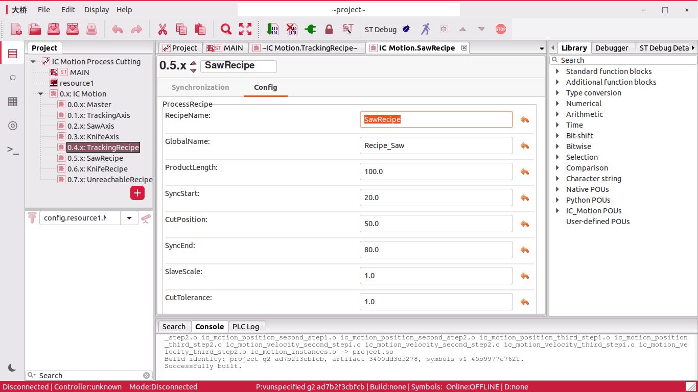
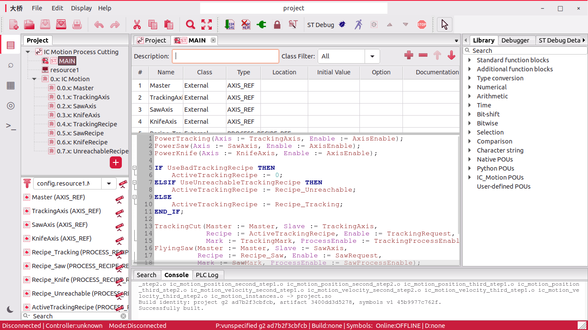
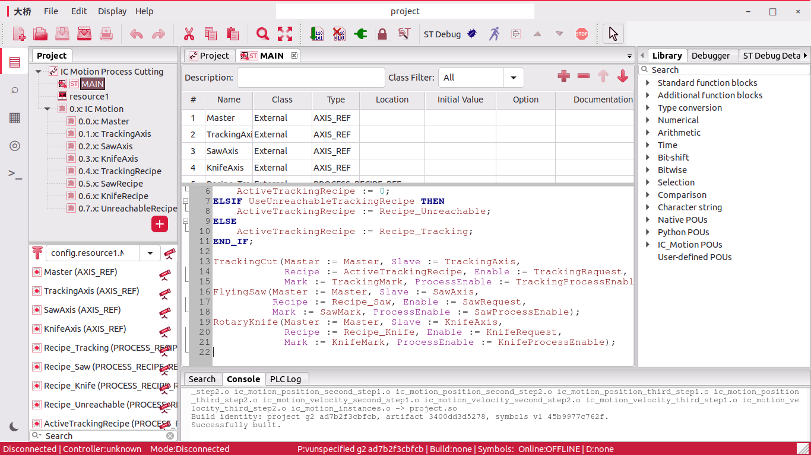

用途：指导读者在 V0.0.17 大桥 IDE 中核对飞剪配方、ST 调用和主机离线验证。当前状态：共用保存工程测试 2/2 PASS、真实 IDE Build PASS；现场飞剪 SKIP。

# 12 飞剪

| 项目 | 可复核值 |
| --- | --- |
| 所需 IDE | V0.0.17 Linux amd64 本地候选；包源码 `8f743aa19cc49012b5cfec38a49d15d95fb9facd` |
| 可打开工程 | [`examples/v0.0.17/beremiz_process_cutting/`](https://github.com/Leo-Hassan/ic-motion-tutorial/tree/main/examples/v0.0.17/beremiz_process_cutting)，入口 `beremiz.xml`；与案例 11/13 同一份工程 |
| 关键 POU / 资源 | `plc.xml/MAIN`、`config/resource1/ProcessTask`；`IC Motion@ic_motion/SawAxis@VirtualAxis/confnode.xml`、`SawRecipe@ProcessRecipe/confnode.xml`、`Master@EncoderAxis/confnode.xml` |
| 源码提交 | `ic-beremiz-motion` `0867ececc3224815e4f0aae07b76b9581f70cfe4`，原路径 `examples/beremiz_process_cutting/` |
| 本次状态 | 包内保存工程两次 Clean Build 与工艺仿真共用案例 11 的一次运行；实机飞剪 SKIP |

## 操作步骤

1. 按[案例 11](11-tracking-cut.md)核对 IDE 包身份，在真实 V0.0.17 IDE 打开该工程的临时副本，确认底栏 `Online:OFFLINE`。
2. 展开 `IC Motion`，双击 `SawAxis`：它是 `VirtualAxis`，不对应现场飞剪滑台。再双击 `SawRecipe`，确认产品长度 100、同步窗口 20..80、切点 50、从轴比例 1、容差 1、标记模式开启。
3. 双击 `MAIN`，定位 `FlyingSaw` 实例和 `SawRequest`、`SawMark`、`SawProcessEnable`。块输入从 `Master` 模拟编码器、`SawAxis` 和 `Recipe_Saw` 取得；夹具在相位 10 给出每产品标记，在同步窗口检查返回及许可。
4. 在未编辑的临时副本按 `F11` 构建，或执行下列命令。它与案例 11 使用相同脚本和同一次保存工程仿真，不能把共用测试计成第二次独立运行。

```sh
./scripts/verify_process_cutting.sh /path/to/ic-platform-V0.0.17-linux-amd64 \
  examples/v0.0.17/beremiz_process_cutting
```



*图 1：步骤 2；真实 V0.0.17 IDE 显示 SawRecipe 的同步窗口、切点与标记参数。*



*图 2：步骤 3；真实 IDE `MAIN` 同屏显示 FlyingSaw、主从轴和资源树。*

## 带注释的 ST 关键片段

```iecst
(* 飞剪滑台为虚轴；只在主机软件仿真中产生位置。 *)
PowerSaw(Axis := SawAxis, Enable := AxisEnable);

(* 配方规定 100 单位产品、20..80 同步窗口、50 切点。 *)
FlyingSaw(Master := Master, Slave := SawAxis,
          Recipe := Recipe_Saw, Enable := SawRequest,
          Mark := SawMark, ProcessEnable := SawProcessEnable);
```

以上来自 `plc.xml/MAIN`，中文注释解释资源含义，完整状态量和全部 ST 以工程文件为准。夹具同时模拟跟踪切与旋切，飞剪证据不能脱离同一共享工程单独计算。

## 预期结果、常见错误与验证范围



*图 3：步骤 4；同一真实 IDE 工程的三个 ST 工艺调用与 Console `Successfully built.`。*

保存工程 C 夹具实际通过 `FlyingSaw.ProductCount=5`、`CutCount=5`、`CutPermit` 脉冲累计 5、`Error=0` 的断言；软件还核对同步和返回阶段。案例 11/13 的同一次测试也检查其他两块。两次包内 Clean Build、独立 CLI 和 GUI Build 的哈希相同，完整值见[跟踪切的共用结果](11-tracking-cut.md)。

| 现象 | 检查位置 |
| --- | --- |
| 没有飞剪切割许可 | 检查 `SawProcessEnable`、`SawMark`、`SawRequest`，以及同步窗口 20..80；只在预期产品窗口处理标记。 |
| 把 `SlaveScale=1` 误认为刀具实际速度 | 这是保存配方中的软件比例；没有真实驱动、行程、制动器或刀具反馈。 |
| 修改 SawRecipe 后清单不匹配 | 原工程带 `project-manifest.json`；请在真实 IDE 保存新副本并重新 Clean Build，勿直接改 XML 后复用原身份。 |

**验证范围：**V0.0.17 包内真实 GUI、虚轴构建和主机软件仿真；现场同步精度、机械返程、工件切口和功能安全均未验证。[上一篇：跟踪切](11-tracking-cut.md) · [下一篇：旋切](13-rotary-knife.md)。
