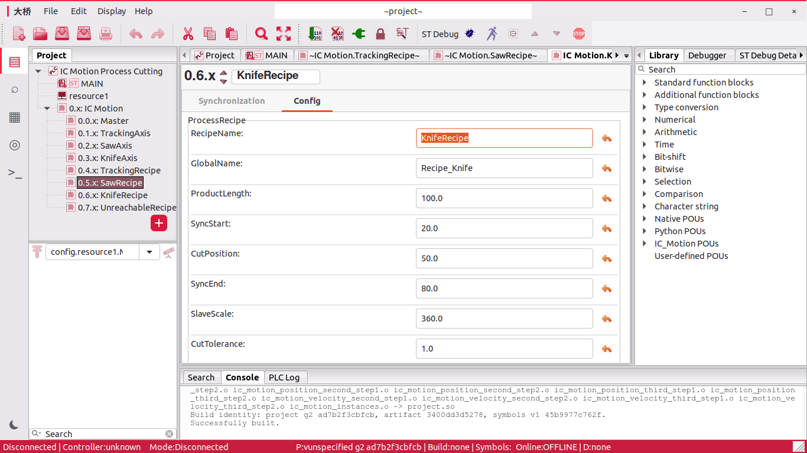
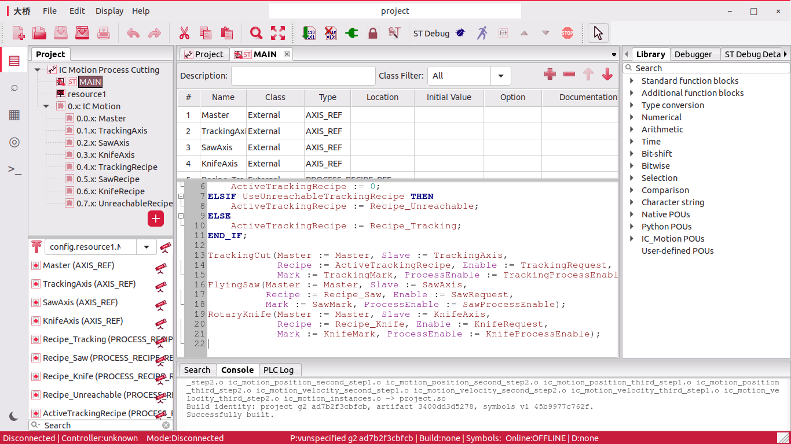

用途：指导读者在 V0.0.17 大桥 IDE 中核对旋切配方、ST 调用和主机离线验证。当前状态：共用保存工程测试 2/2 PASS、真实 IDE Build PASS；现场旋切 SKIP。

# 13 旋切

| 项目 | 可复核值 |
| --- | --- |
| 所需 IDE | V0.0.17 Linux amd64 本地候选；包源码 `8f743aa19cc49012b5cfec38a49d15d95fb9facd` |
| 可打开工程 | [`examples/v0.0.17/beremiz_process_cutting/`](https://github.com/Leo-Hassan/ic-motion-tutorial/tree/main/examples/v0.0.17/beremiz_process_cutting)，入口 `beremiz.xml`；与案例 11/12 同一份工程 |
| 关键 POU / 资源 | `plc.xml/MAIN`、`config/resource1/ProcessTask`；`IC Motion@ic_motion/KnifeAxis@VirtualAxis/confnode.xml`、`KnifeRecipe@ProcessRecipe/confnode.xml`、`Master@EncoderAxis/confnode.xml` |
| 源码提交 | `ic-beremiz-motion` `0867ececc3224815e4f0aae07b76b9581f70cfe4`，原路径 `examples/beremiz_process_cutting/` |
| 本次状态 | 包内保存工程两次 Clean Build 与工艺仿真共用案例 11/12 的一次运行；实机旋切 SKIP |

## 操作步骤

1. 按[案例 11](11-tracking-cut.md)核对 V0.0.17 IDE 包版本并在临时副本打开同一工程，确认 `Online:OFFLINE`。
2. 展开 `IC Motion`，双击 `KnifeAxis` 和 `KnifeRecipe`。从轴是 VirtualAxis；配方产品长度 100、同步起点 20、切点 50、同步终点 80、`SlaveScale=360`、容差 1、标记模式开启。360 是本软件配方的从轴比例，不是机械实测角度。
3. 双击 `MAIN`，定位 `RotaryKnife` 的 `Master`、`KnifeAxis`、`Recipe_Knife`、`KnifeRequest`、`KnifeMark` 和 `KnifeProcessEnable`。比较同页飞剪调用，可以看到三个块共用模拟主轴但从轴和配方独立。
4. 在未修改的临时副本按 `F11` 构建；再用下列命令运行包内保存工程仿真。本章与案例 11/12 共用一次测试，具体 PASS 和哈希见 `TEST_REPORT.md`。

```sh
./scripts/verify_process_cutting.sh /path/to/ic-platform-V0.0.17-linux-amd64 \
  examples/v0.0.17/beremiz_process_cutting
```



*图 1：步骤 2；真实 V0.0.17 IDE 的 KnifeRecipe、360 比例和同步窗口。*



*图 2：步骤 3～4；真实 IDE 的 RotaryKnife 与另外两个工艺块、资源树及成功构建 Console 同屏。*

## 带注释的 ST 关键片段

```iecst
(* 旋切刀轴为虚轴；软件配方用 SlaveScale=360。 *)
PowerKnife(Axis := KnifeAxis, Enable := AxisEnable);

(* 请求、标记和切割许可由仿真夹具按扫描周期给出。 *)
RotaryKnife(Master := Master, Slave := KnifeAxis,
            Recipe := Recipe_Knife, Enable := KnifeRequest,
            Mark := KnifeMark, ProcessEnable := KnifeProcessEnable);
```

片段对应 `plc.xml/MAIN`；中文注释是教程说明，完整 ST 和资源仍以保存工程为准。

## 预期结果、常见错误与验证范围

保存工程 C 夹具实际通过 `RotaryKnife.ProductCount=5`、`CutCount=5`、`CutPermit` 脉冲累计 5、`Error=0` 的断言，并检查刀轴软件位置持续增加（终值 `>1400`）；这只表示虚轴软件轨迹。两次 Clean Build、独立 CLI 与 GUI 构建哈希一致，完整值见[跟踪切的共用结果](11-tracking-cut.md)。

| 现象 | 检查位置 |
| --- | --- |
| 没有旋切许可 | 检查 `KnifeRequest`、`KnifeMark`、`KnifeProcessEnable`、同步窗口和 `Error`；标记模式需要每产品正确边沿。 |
| 软件刀轴位置超过一圈 | 本例连续产品的虚轴累计位置可超过 360；不能直接推断机械多圈能力或允许绕线圈数。 |
| 把 `SlaveScale=360` 用作驱动参数 | 这是离线配方数值，没有板端驱动映射、齿比或实际零位验收；真实设备参数必须另行设计和审批。 |

**验证范围：**V0.0.17 包内真实 GUI、保存工程虚轴构建及主机软件仿真；没有驱动、刀具、机械防护、板端 Stop/Transfer/Run、Force、SDO 写入或电机运动。[上一篇：飞剪](12-flying-saw.md)。
