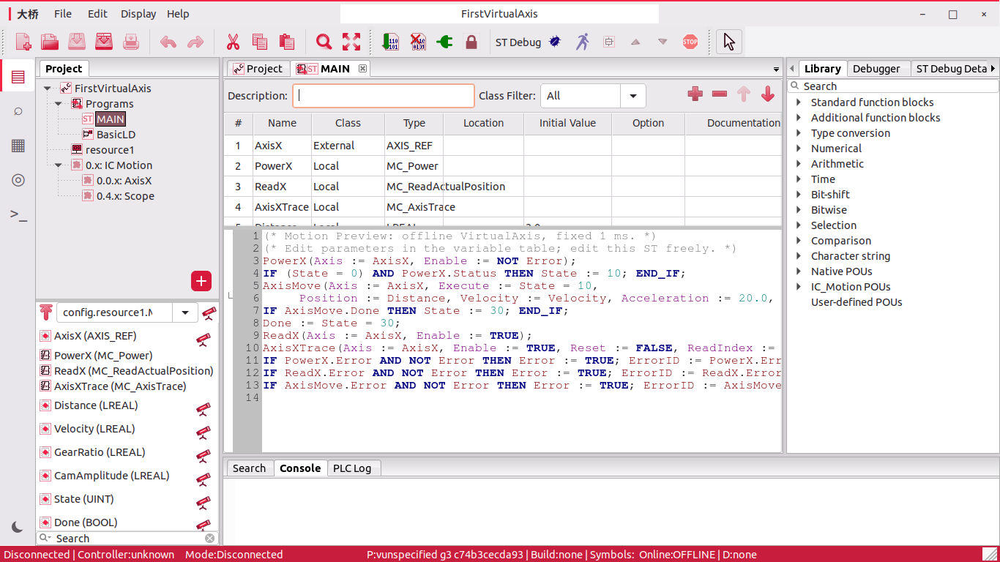
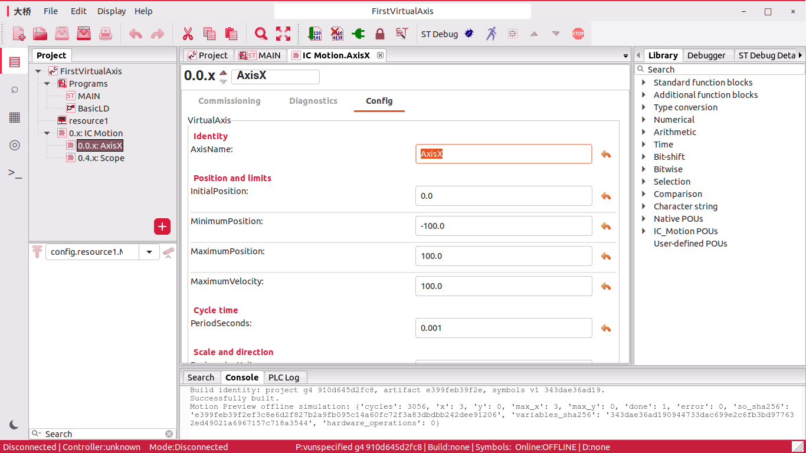
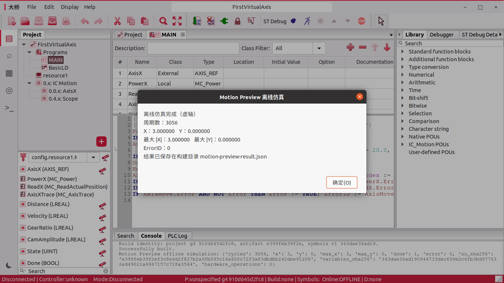

用途：说明本版 IDE 的安全离线操作入口和截图对应的实际步骤。当前状态：打开虚轴工程、编辑页、参数页、Clean Build 与离线仿真已在 V0.0.17 包验证。

# 软件操作

## 启动与打开工程

1. 在 V0.0.17 主包根目录执行 `bin/ic-platform --version`，核对输出为 `Industrial Control Platform V0.0.17`。按包内说明启动 IDE；仅学习离线案例时设置 `IC_SKIP_ERPC_TUNNEL=1`。
2. 在 IDE 中选 **File → Open Project**，或按 `Ctrl+O`，选择本仓库 `examples/v0.0.17/FirstVirtualAxis/` 目录。工程入口文件为该目录的 `beremiz.xml`；选择的是目录。
3. 左侧 **Project** 工程树展开 **Programs → MAIN**，双击 `MAIN` 进入 ST 编辑器；展开 **IC Motion → AxisX** 可打开轴页。窗口底部应保持 `Disconnected` 和 `Online:OFFLINE`。



*图：V0.0.17 包内真实 IDE，已打开教程工程 `FirstVirtualAxis` 的 `plc.xml/MAIN`。左侧树同时显示 `BasicLD`、`AxisX`、`Scope`。*

## 编辑、配置与构建

`MAIN` 上方是变量表，下方是可编辑 ST。修改 `Distance` 或 `Velocity` 后按 `Ctrl+S` 保存。双击 **IC Motion → AxisX**，在 **Config** 页查看 `MinimumPosition=-100.0`、`MaximumPosition=100.0`、`MaximumVelocity=100.0` 和 `PeriodSeconds=0.001`。轴页 **Commissioning** 为只读诊断，不会自行连接或运行设备。



*图：V0.0.17 包内真实 `AxisX` 参数页；这是项目副本的虚轴配置，不是实轴限位验收。*

保存后可在 IDE 菜单执行离线 Build，也可用教程仓库的脚本在临时副本 Clean Build：

```sh
./scripts/clean_build.sh \
  /path/to/ic-platform-V0.0.17-linux-amd64 \
  examples/v0.0.17/FirstVirtualAxis V0.0.17
```

脚本核对包版本，使用包内 Beremiz、MATIEC 和 IC Motion 扩展，只在临时目录生成 `project.so` 与 `VARIABLES.csv`。本次结果见[案例 01](cases/01-first-virtual-axis.md)。

## 离线仿真与结果

打开 `FirstVirtualAxis` 后按 `Ctrl+Alt+M`，等待“Motion Preview 离线仿真”结果框。该入口只接受未连接的 `LOCAL://`、一至两个 `VirtualAxis` 和单个 1 ms 任务；若工程包含真实轴、传输节点或在线连接，会拒绝。



*图：V0.0.17 包内真实离线仿真，3056 周期后 X=3.000000、ErrorID=0；底部 Console 显示构建与仿真结果。*

结果文件在本地工程副本 `build/motion-preview-result.json`，应检查 `done=1`、`error=0`、`hardware_operations=0`。`build/` 是生成物，不属于教程仓库。若结果框报告参数或构建错误，回到 ST、轴参数和底部 Console 核对具体错误位置；不要用 Force 绕过故障。

ST 断点/单步的本地主机回环步骤见[案例 03](cases/03-st-breakpoint-step.md)；生产在线只读监视未在当前版本实测。本页的批量离线仿真不具备断点与单步能力。

已发现 V0.0.17 的特定 LD 编辑失败：在 Basic 17 LD 临时副本中把 `Enable` 触点从 Normal 改为 Negated 后，图形编辑器保存出回环连线，随后 `F11` 抛 `RecursionError`。详见[案例 04](cases/04-ld-edit-simulate.md)；原工程的 Build 和保存工程仿真结果不覆盖该失败。

V0.0.17 正式启动器尚未把包内 `ic-device-library/python` 加入映射编辑器的 Python 路径；打开 `Mapping` 页会报 `No module named ic_device_catalog`。本版本的[案例 06](cases/06-device-mapping-cia402.md)提供只启动包内 GUI 的版本核对离线入口；两工程 Clean Build 与模拟过程映像测试结果不覆盖正式启动器缺陷。
