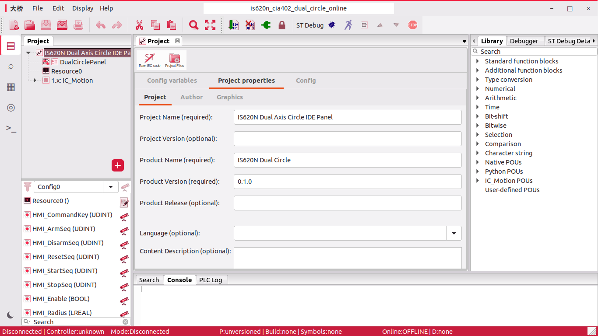

用途：说明教程版本、IDE 包与示例工程的可追溯关系。当前状态：V0.0.17 本地候选软件门禁通过，公开 IDE 发布未完成。

# 版本与证据

| 对象 | 固定身份 |
| --- | --- |
| IDE 包版本 | `Industrial Control Platform V0.0.17`，Linux amd64，本地候选 |
| 包内改版 UI 来源 | `beremiz` `06f5b1e0e45faecac96d790ab03e57be46d4fd2d` |
| IC Motion 扩展来源 | `ic-beremiz-motion` `0867ececc3224815e4f0aae07b76b9581f70cfe4` |
| 发布源码提交 | `ic-platform-release` `8f743aa19cc49012b5cfec38a49d15d95fb9facd` |
| 主包归档 SHA-256 | `5606204f00e3bc1d21fbdf1690f57b964f75d1889e5f17c3c0efa69e162216e5` |
| 本地全新安装结果 | PASS；包内 17 项检查、四模板真实 wx GUI、双轴离线产物逐字节比对；硬件操作 0 |

本地报告追记提交为 `53daa23`，晚于归档；它没有改变归档对应的源码提交。没有 V0.0.17 发布标签和公开下载地址，**本地候选不得称为已发布 IDE 版本**。网站目录 `v0.0.17/` 只对应这个精确版本；`v0.0.14/` 继续保留，不覆盖旧版。

运行包根的 `bin/ic-platform --version` 必须返回上表版本，再用进程路径确认打开的是该包的 `Beremiz.py`。窗口标题显示工程名和项目状态，不能单独证明 IDE 包版本。

*图：2026-11-18 从上述本地 V0.0.17 主包启动的真实 wx 窗口；显示 IS620N 双轴工程的离线打开状态，未连接设备。截图原始来源及摘要见[截图来源](../assets/images/v0.0.17/PROVENANCE.md)。*

截图与离线构建只能证明软件行为。V0.0.17 未进行板端 Stop、Transfer、Run、Force、SDO 写入、驱动参数修改或电机运动；历史实机报告不继承为本版本验收。
